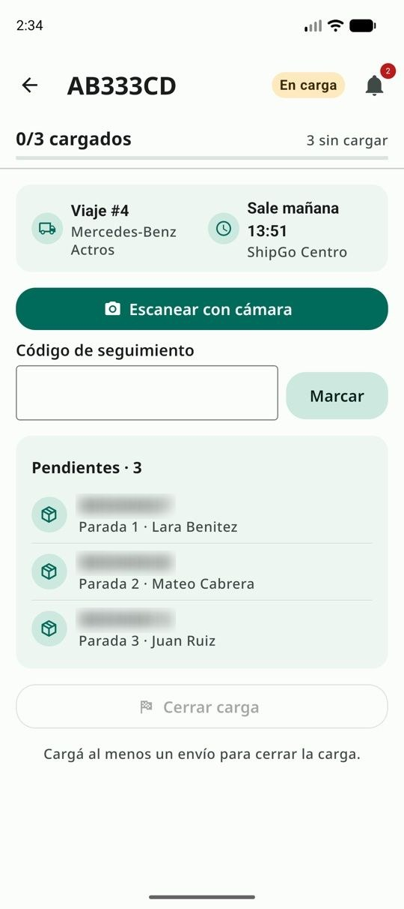
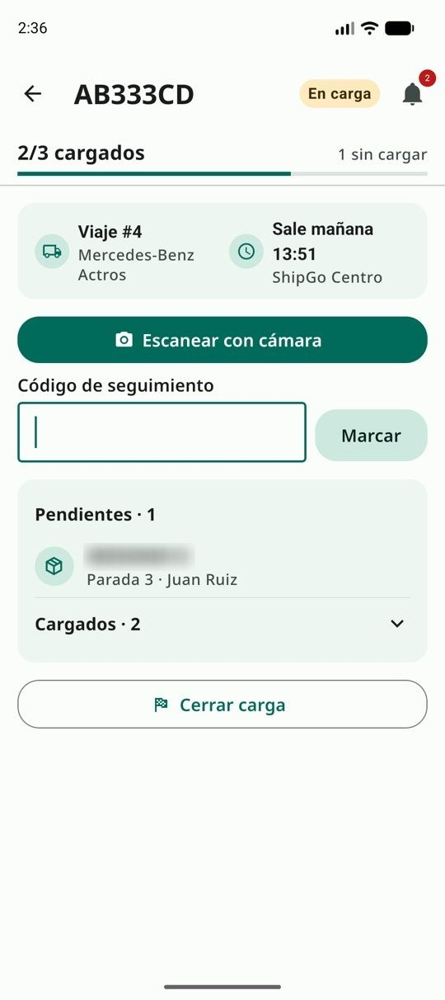
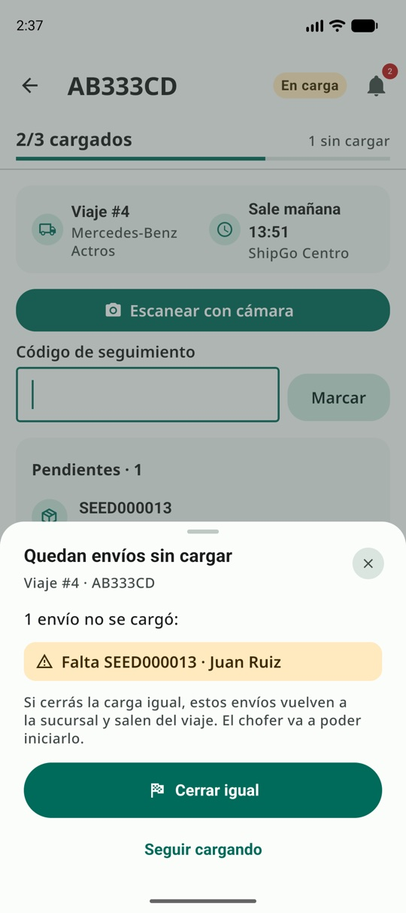

import { Steps } from '@astrojs/starlight/components';

Esta página es para el **Operario de carga**: quien carga el vehículo antes de que salga. Si tu usuario tiene rol de carga, la app suma la pestaña **Carga**. (Si tu usuario tiene los dos roles, vas a ver las pestañas de Chofer y la de carga.)

La carga es un paso previo al viaje: **el Chofer no puede iniciar el viaje hasta que cierres la carga**.

## La lista de cargas

La pestaña **Carga** lista los viajes de tu sucursal que hay que cargar, agrupados en:

- **En carga**: la carga ya empezó.
- **Planificados**: viajes confirmados que todavía no se empezaron a cargar.
- **Listos para salir**: la carga ya se cerró (podés reabrirla si hace falta).

Cada viaje se identifica por su **patente**. Como en el playón se busca el camión por patente, arriba hay un buscador (**Buscar por patente**).

## Armar la carga con el checklist

<Steps>

1. Abrí el viaje. Si todavía no empezó, tocá **Empezar carga**.
2. Verás el avance (**0/3 cargados**), los datos del vehículo y del horario de salida, y la lista **Pendientes** con cada envío y su número de parada.
3. Marcá cada envío a medida que lo subís al vehículo, de cualquiera de estas formas:
   - **Escanear con cámara**: apuntá al código del envío.
   - **Código de seguimiento**: escribí el código y tocá **Marcar**.
   - Tocá el envío en la lista.
4. A medida que marcás, los envíos pasan a **Cargados** y la barra avanza.

</Steps>

*Checklist recién abierto: 0/3 cargados. **Cerrar carga** está deshabilitado.*

*Con 2 de 3 envíos cargados, **Cerrar carga** ya se puede usar.*

:::tip
Si te equivocaste y marcaste un envío que no cargaste, mantené presionado ese envío y elegí **Deshacer marca**.
:::

:::note
Si escaneás un código que **no pertenece al viaje**, la app muestra **"Este envío no es de este viaje"** y, si lo encuentra, te dice en qué viaje va (número, patente y fecha de salida). No lo cargues en este vehículo.
:::

## Cerrar la carga

**Cerrar carga** se habilita cuando cargaste al menos un envío. Al cerrarla, el viaje queda **Listo para salir** y el Chofer puede iniciarlo.

Si quedan envíos sin cargar, la app te avisa antes con **"Quedan envíos sin cargar"** y te muestra cuáles faltan.

*Cierre con faltantes: elegí **Cerrar igual** o **Seguir cargando**.*

- **Seguir cargando**: volvés al checklist para terminar.
- **Cerrar igual**: los envíos que faltan **vuelven a la sucursal y salen del viaje**. El Chofer va a poder iniciarlo con lo que sí se cargó.

:::caution
**Cerrar igual** saca los envíos faltantes del viaje. Confirmá que realmente no están antes de cerrar.
:::

### Reabrir una carga

Si cerraste la carga y hay que corregir algo, abrí el viaje desde **Listos para salir** y tocá **Reabrir carga**. El viaje vuelve a **En carga**.

### Salir sin cerrar

Si salís del checklist con la carga abierta, la app te avisa **"La carga sigue abierta"**: mientras no la cierres, el Chofer no puede iniciar el viaje. Elegí **Seguir cargando** o salí de todas formas.

## Sin conexión

Si perdés señal mientras cargás, las marcas **se guardan en el teléfono** y se envían en orden cuando vuelve la conexión: los envíos se ven como cargados igual. Tené en cuenta que:

- **Deshacer una marca** y **cerrar la carga** necesitan conexión. Para cerrar, además, tienen que haberse enviado todas las marcas pendientes.
- Si la conexión tarda, esperá a que se envíen las marcas antes de cerrar la carga.
