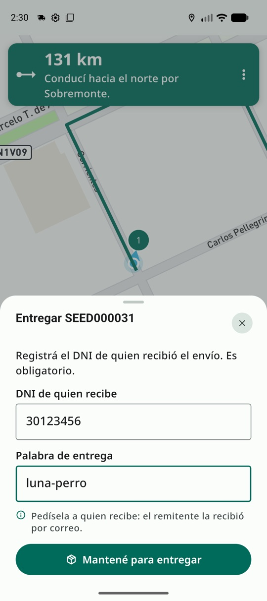
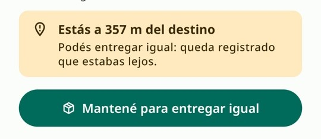
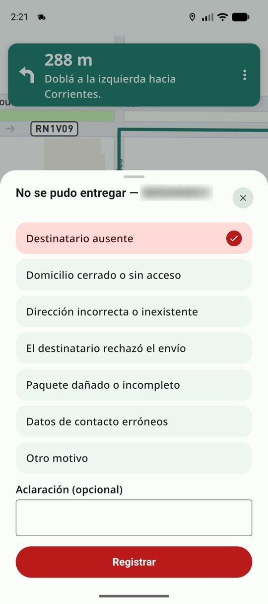

import { Steps } from '@astrojs/starlight/components';

En cada parada tenés que dejar registrado qué pasó con cada envío: **entregado** o **no se pudo entregar**. Ese registro es lo que ven la empresa y el cliente en el seguimiento.

## Abrir la parada

Cuando llegues, tocá **Entregar** en la franja del mapa (o abrí la parada desde la lista de paradas). Se abre una hoja con los envíos de esa parada y el avance (por ejemplo, "0/2 envíos resueltos").

## Entrega a domicilio

En una parada a domicilio cada envío se entrega por separado: tocá **Entregar** en el envío que corresponda.

<Steps>

1. Escribí el **DNI de quien recibe**. Es obligatorio.
2. Si el envío tiene **palabra de entrega**, pedísela a quien recibe y escribila en **Palabra de entrega**. La palabra le llegó por correo al remitente, que se la pasa a quien recibe, y es obligatoria **solo si el envío la tiene**: si el envío no tiene palabra, el campo directamente no aparece.
3. Mantené presionado el botón **Mantené para entregar** hasta que se confirme (un instante alcanza). Esto evita entregas marcadas por error con un toque.
4. Aparece **¡Entrega registrada!**. Elegí **Siguiente envío** si quedan más en la parada, o **Ir a la parada siguiente**.

</Steps>

*Registro de una entrega a domicilio con DNI y palabra de entrega. (Los datos de la captura son de prueba.)*

:::caution
Sin el DNI, o sin la palabra cuando el envío la tiene, la app no deja confirmar. Si la palabra no coincide con la del envío, la entrega se rechaza y la hoja queda abierta: corregí la palabra y volvé a intentar sin perder el DNI que ya escribiste.
:::

## Entrega a sucursal

En una parada **Entrega a sucursal** dejás **todos los envíos de una sola vez**. No pide DNI ni palabra de entrega: solo tenés el campo **Quién recibió (opcional)** para anotar el nombre de la persona que los recibió en la sucursal. Mantené presionado **Mantené para entregar N envíos** para confirmar.

## Si estás lejos del destino

Antes de confirmar, la app verifica la distancia entre tu posición y el destino. Si estás fuera del radio de entrega, aparece un aviso amarillo, por ejemplo **"Estás a 357 m del destino. Podés entregar igual: queda registrado que estabas lejos."**, y el botón pasa a decir **Mantené para entregar igual**.

*Aviso de fuera de radio: la entrega se puede hacer igual y queda anotada la distancia.*

:::note
Podés entregar igual: no se bloquea nada. Pero queda registrado que estabas lejos, y la confirmación te lo recuerda ("Quedó anotado que estabas a … del destino"). Usalo solo cuando haya un motivo real, por ejemplo, que el GPS esté impreciso.
:::

## Si no se pudo entregar

Si no lograste entregar un envío a domicilio, tocá **No se pudo entregar** en ese envío.

<Steps>

1. Elegí el **motivo** de la lista.
2. Si querés, agregá una **Aclaración (opcional)** con más detalle. Si elegís **Otro motivo**, en cambio, tenés que describirlo (mínimo 3 caracteres).
3. Tocá **Registrar**. Aparece "Entrega fallida registrada." y el envío pasa a **No entregado** en el seguimiento.

</Steps>

*La hoja de fallo de entrega, con los motivos disponibles.*

Los motivos disponibles son siete:

1. Destinatario ausente
2. Domicilio cerrado o sin acceso
3. Dirección incorrecta o inexistente
4. El destinatario rechazó el envío
5. Paquete dañado o incompleto
6. Datos de contacto erróneos
7. Otro motivo

:::tip
Elegí el motivo más preciso y sumá una aclaración corta cuando ayude (por ejemplo, el horario al que pasaste). Le sirve al equipo de operaciones para entender qué pasó.
:::

## Última entrega

Cuando se resuelve la última parada, la confirmación te dice **Última entrega** y cuántas paradas quedaron resueltas. Podés **Ir al viaje y finalizarlo** o **Quedarme en el mapa**. Más detalle en [Iniciar el viaje](/manual/app-mobile/inicio-jornada/#finalizar-el-viaje).

## Sin conexión

Si no tenés señal cuando confirmás, la entrega **no se pierde**: la app muestra **Entrega guardada**, "Pendiente de envío", y la manda sola cuando vuelva la conexión. Ver [Sin conexión](/manual/app-mobile/sin-conexion/).
