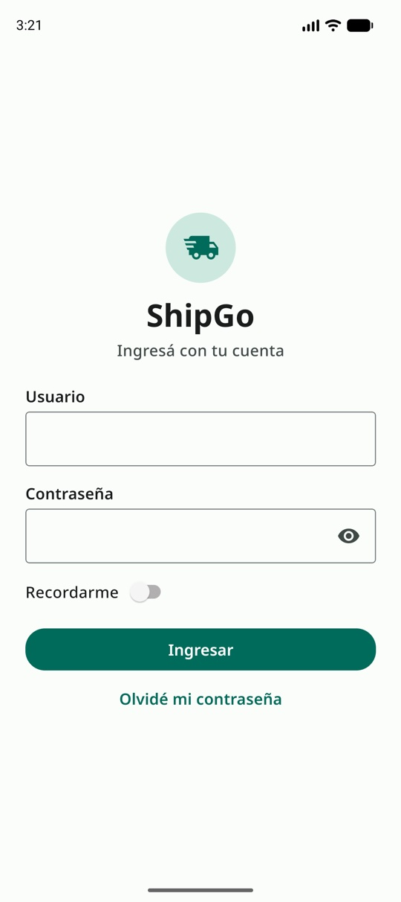
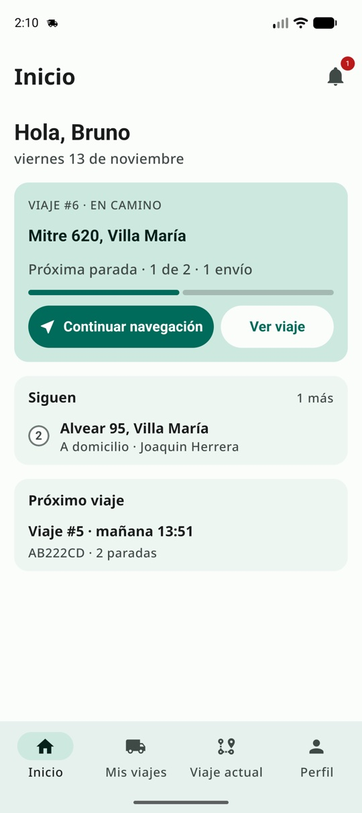
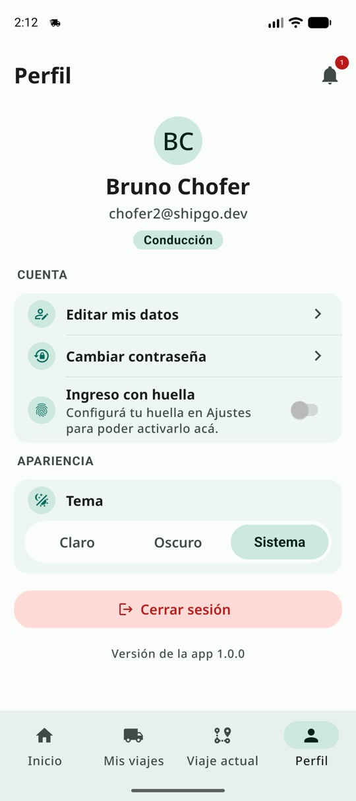

import { Steps } from '@astrojs/starlight/components';

La app de **ShipGo!** es la herramienta de trabajo del chofer y del personal de carga. Con ella ves tus viajes, navegás hasta cada parada, registrás las entregas y avisás si pasa algo en el camino. Esta página explica cómo entrar, cómo se organiza la app y cómo ajustar tu perfil.

## Ingresar a la app

*Pantalla de ingreso: usuario, contraseña y el botón **Ingresar**.*

<Steps>

1. Abrí la app **ShipGo!**.
2. Escribí tu **usuario** y tu **contraseña**. Con el ícono del ojo podés ver lo que escribiste.
3. Si querés que la app te recuerde el usuario la próxima vez, activá **Recordarme**.
4. Tocá **Ingresar**.

</Steps>

Si te olvidaste la contraseña, tocá **Olvidé mi contraseña**, escribí tu email y seguí las instrucciones del correo que te llega.

:::note
La app es solo para **choferes** y **personal de carga**. Si tu cuenta es de administrador u operador, la app te lo avisa y tenés que trabajar desde el [panel web](/manual/panel-web/centro-de-accion/).
:::

:::caution
Si ves "Demasiados intentos", esperá el tiempo que indica el mensaje antes de probar de nuevo. Si el mensaje dice que tus datos son incorrectos, revisá el usuario y la contraseña, o pedile a tu administrador que te restablezca el acceso.
:::

## Ingresar con la huella

Si tu teléfono tiene huella (o reconocimiento facial) configurada, después de tu primer ingreso la app te ofrece activar el ingreso biométrico. Es opcional: si lo rechazás, entrás igual con usuario y contraseña.

Cuando está activado, al abrir la app aparece el pedido de huella y, si lo cancelás, podés ingresar a mano o tocar el botón de ingreso con huella.

Para activarlo o desactivarlo más tarde, andá a **Perfil → Ingreso con huella**. Para activarlo, la app te pide confirmar tu usuario y contraseña. Si todavía no configuraste una huella en el teléfono, el interruptor te indica que lo hagas desde los Ajustes del celular.

:::tip
Si cambiás las huellas registradas en el teléfono, la app desactiva el ingreso con huella por seguridad y te avisa. Entrá con usuario y contraseña y volvé a activarlo desde **Perfil**.
:::

## Las pestañas de la app

Abajo de la pantalla hay una barra de pestañas. Cuáles ves depende de tu rol y de si tenés un viaje en curso:

| Pestaña | Qué muestra | Quién la ve |
|---------|-------------|-------------|
| **Inicio** | Tu resumen del día: viaje en curso, próximas paradas y próximo viaje | Todos |
| **Mis viajes** | La lista de tus viajes, con filtros | Choferes |
| **Viaje actual** | Abre directamente el mapa de navegación | Choferes, solo mientras tenés un viaje en curso |
| **Carga** | Los viajes que se están cargando y su checklist | Personal de carga |
| **Perfil** | Tus datos, el tema y el cierre de sesión | Todos |

En un chofer con un viaje en curso la barra tiene **cuatro pestañas**: Inicio, Mis viajes, Viaje actual y Perfil. Sin viaje en curso, la pestaña **Viaje actual** desaparece.

*Inicio de un chofer con un viaje en camino. Abajo, la barra de cuatro pestañas.*

En el borde superior de cada pantalla hay una **campana** con un número rojo: son tus notificaciones sin leer (por ejemplo, un viaje nuevo asignado). Tocala para verlas.

## Tu perfil

*La pestaña **Perfil**.*

Desde **Perfil** podés:

- **Cambiar la foto**: tocá la foto o las iniciales de arriba.
- **Editar mis datos**: tu información personal y de contacto.
- **Cambiar contraseña**: te pide la actual y la nueva (mínimo 8 caracteres). La nueva no puede ser igual a la actual.
- **Ingreso con huella**: activarlo o desactivarlo.
- **Tema**: elegí **Claro**, **Oscuro** o **Sistema** (sigue el modo de tu teléfono).
- **Sonido al escanear** (solo personal de carga): un pitido al confirmar o rechazar un código.
- **Cerrar sesión**: la app te pide confirmar. Para volver a entrar vas a necesitar tu usuario y contraseña.

:::caution
Cerrá sesión si le prestás el teléfono a otra persona. Al cerrar sesión se deja de compartir tu ubicación.
:::
