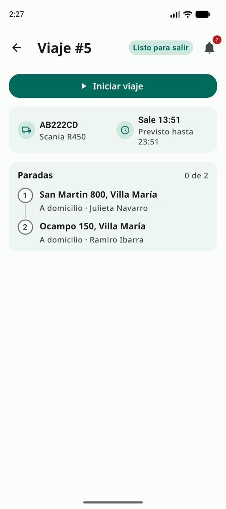

import { Steps } from '@astrojs/starlight/components';

Un viaje se inicia cuando el vehículo ya está cargado y vos estás listo para salir. Al iniciarlo, la app abre el mapa y empieza a compartir tu ubicación con la empresa.

## Antes de salir

Solo podés iniciar un viaje que esté **Listo para salir**. Eso significa que el personal de carga ya cerró la carga.

*Un viaje **Listo para salir**: arriba el botón **Iniciar viaje**, después el vehículo, el horario y las paradas.*

Si el botón **Iniciar viaje** no aparece, puede ser por alguno de estos motivos:

- **La carga todavía no se cerró.** Verás un aviso: "El operario de carga está cargando el viaje. Vas a poder iniciarlo cuando cierre la carga." (o, si no empezó: "La carga de este viaje todavía no empezó"). Esperá a que la cierren.
- **Ya tenés otro viaje en curso.** No se puede iniciar un viaje mientras otro esté **En camino** o **Con problemas**. Terminá o reanudá ese primero.
- **Todavía no aceptaste el viaje.** Aceptalo desde **Mis viajes**.

## Iniciar el viaje

<Steps>

1. Entrá al viaje desde **Inicio** o **Mis viajes**.
2. Tocá **Iniciar viaje**. Se abre la pregunta **¿Salir ahora?** con un resumen: cantidad de paradas, la primera dirección, los envíos cargados y el aviso de que el seguimiento por GPS se activa mientras conducís.
3. Tocá **Iniciar y abrir el mapa**. El viaje pasa a **En camino** y se abre la [navegación](/manual/app-mobile/navegacion/).

</Steps>

### Permiso de ubicación

La primera vez, la app te explica por qué necesita tu ubicación y después te pide el permiso del teléfono. Para que el seguimiento siga funcionando con la pantalla bloqueada, además hace falta elegir **Permitir todo el tiempo** en los Ajustes del teléfono: la app te lleva con el botón **Ir a Ajustes**.

:::caution
Si negás el permiso de ubicación, la empresa no va a ver tu recorrido y la navegación no puede seguirte. Si lo rechazaste por error, activalo desde los Ajustes del teléfono.
:::

Mientras el viaje está en curso, tu teléfono muestra una notificación permanente (**Viaje actual**) indicando que se comparte tu ubicación. Desde esa notificación podés volver a la navegación y acceder rápido a **Entregar** o **Incidente**.

## Qué ve la empresa mientras viajás

Mientras estás **En camino**, la app envía tu posición automáticamente cada poco tiempo, de a una y en el orden en que se registró. La empresa la ve en el mapa en vivo del panel web. Si perdés señal, las posiciones pendientes quedan guardadas y se envían, en orden, cuando vuelve la conexión.

## Finalizar el viaje

Cuando resolviste todas las paradas (entregadas o con fallo registrado), el viaje se puede cerrar.

<Steps>

1. Después de la última entrega, la app te ofrece **Ir al viaje y finalizarlo**. Si preferís seguir en el mapa, tocá **Quedarme en el mapa**.
2. En el detalle del viaje, tocá **Finalizar viaje**.
3. Confirmá en **¿Finalizar el viaje?**. Se cierra el viaje y se apaga el GPS.

</Steps>

:::note
Si todavía queda alguna parada sin resolver, **Finalizar viaje** aparece deshabilitado con el aviso de cuántas paradas te faltan. Resolvelas primero.
:::
