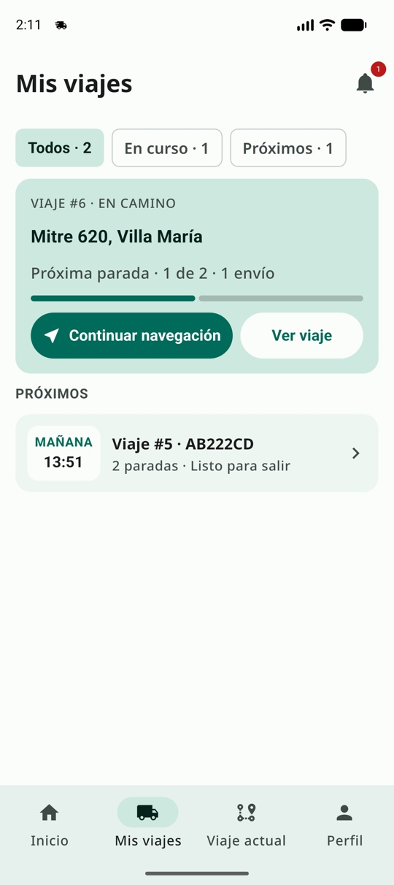

import { Steps } from '@astrojs/starlight/components';

Al abrir la app empezás en **Inicio**, un resumen de tu jornada. Para ver todos tus viajes, usá la pestaña **Mis viajes**.

## Inicio: tu resumen del día

La pantalla **Inicio** te saluda con tu nombre y la fecha, y muestra según el momento:

- **El viaje en curso**: la tarjeta verde con el número del viaje, su estado (por ejemplo **En camino**), la próxima parada, el avance por paradas y dos botones: **Continuar navegación** (abre el mapa) y **Ver viaje** (abre el detalle).
- **Siguen**: las paradas que vienen después de la actual.
- **Próximo viaje**: tu siguiente viaje, con el día y la hora de salida, la patente y la cantidad de paradas.

Si todavía no tenés viajes, vas a ver "No tenés viajes asignados". Cuando te asignen uno, aparece acá.

## Mis viajes

*La pestaña **Mis viajes**: filtros con contadores arriba y los viajes agrupados abajo.*

Arriba hay tres filtros, cada uno con la cantidad de viajes que contiene:

| Filtro | Qué muestra |
|--------|-------------|
| **Todos** | Todos tus viajes: en curso, próximos y finalizados |
| **En curso** | El viaje que estás haciendo ahora |
| **Próximos** | Los viajes que todavía no salieron |

Cada viaje se identifica como **Viaje #número · patente** y muestra su estado. Los próximos indican el día y la hora de salida (por ejemplo, "Mañana 13:51") y si ya están **Listos para salir**. Tocá un viaje para ver su detalle: vehículo, horario previsto y la lista de paradas en orden.

### Estados de un viaje

| Estado | Qué significa para vos |
|--------|------------------------|
| **Pendiente de aceptar** | Te ofrecieron el viaje y tenés que aceptarlo o rechazarlo |
| **Planificado** | Viaje confirmado, todavía sin carga |
| **En carga** | El personal de carga está cargando el vehículo |
| **Listo para salir** | La carga se cerró: ya podés iniciar el viaje |
| **En camino** | Estás haciendo el viaje |
| **Con problemas** | Reportaste un incidente y el viaje quedó en pausa |
| **Finalizado** | El viaje terminó |
| **Cancelado** | Un administrador canceló el viaje: no tenés acciones para hacer |

## Aceptar o rechazar un viaje

Cuando te ofrecen un viaje, aparece como **Pendiente de aceptar** con el botón **Aceptar viaje**.

<Steps>

1. Entrá al viaje desde **Inicio** o **Mis viajes** y revisá fecha, vehículo y paradas.
2. Tocá **Aceptar viaje** y confirmá. Quedás como chofer del viaje y pasa a *Planificado*.
3. Si no podés hacerlo, tocá **Rechazar** y confirmá: se lo ofrecen a otro chofer. **No se puede deshacer.**

</Steps>

:::tip
Mirá la campana de notificaciones: ahí te avisan cuando hay un viaje nuevo o cuando cambia algo en uno tuyo.
:::

:::note
Si un administrador te saca de un viaje, la app te lo avisa, deja de compartir tu ubicación para ese viaje y vuelve a **Mis viajes**.
:::
