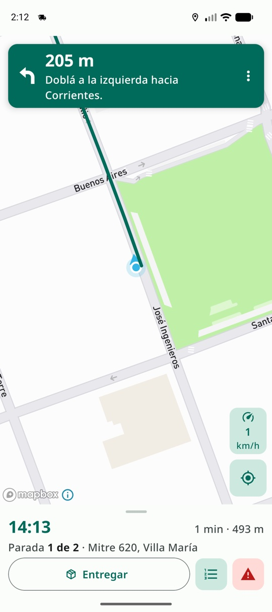
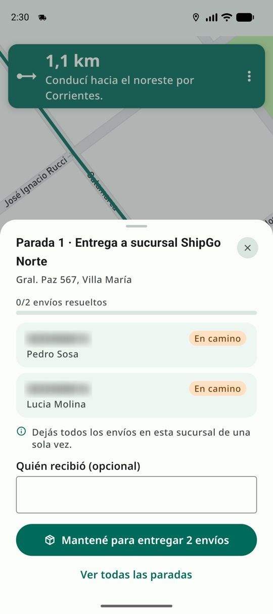

La **navegación** es la pantalla principal mientras conducís: te muestra el mapa, la ruta hasta la próxima parada y las indicaciones de giro.

## Cómo llegar a la navegación

- Al iniciar el viaje, la app abre el mapa sola.
- Después, tocá la pestaña **Viaje actual**, o **Continuar navegación** en **Inicio**, o el botón de la notificación del viaje.

*La navegación: indicación de giro arriba, mapa en el medio y la franja de la parada abajo.*

## Qué ves en pantalla

- **Cartel verde de arriba**: la próxima maniobra, con la distancia y la indicación en castellano ("Doblá a la izquierda hacia…"). Se actualiza a medida que avanzás.
- **Mapa**: tu posición, la ruta en verde y las paradas numeradas.
- **Velocidad**: tu velocidad actual, sobre el botón de centrar.
- **Botón de centrar**: si moviste el mapa con el dedo, tocalo para que vuelva a seguirte.
- **Menú de los tres puntos** (arriba a la derecha del cartel): **Ver detalle del viaje** y **Salir del mapa**. Salir del mapa no frena el viaje.
- **Franja de abajo**: la hora estimada de llegada, el tiempo y la distancia que faltan, **Parada X de Y** con su dirección y tres botones: **Entregar**, la lista de **Paradas** y el botón rojo de **Incidente**.

Si te desviás de la ruta, la app **recalcula** el camino sola. Si no puede hacerlo, te avisa y sigue mostrando la ruta original.

## Ver las paradas

Deslizá la franja de abajo hacia arriba, o tocá el botón de la lista, para ver todas las paradas del viaje en orden con su estado. Desde ahí podés abrir la que necesites.

### Parada de sucursal o de domicilio

Hay dos tipos de parada, y la app te lo indica en cada una:

| Tipo | Cómo se ve | Cómo se entrega |
|------|-----------|-----------------|
| **A domicilio** | El título es la dirección de entrega y la persona destinataria | Se entrega **envío por envío**, con DNI de quien recibe |
| **Entrega a sucursal** | El título dice "Entrega a sucursal …" y lista todos los envíos de la parada | Se dejan **todos los envíos juntos** de una sola vez |

Las dos se explican en [Entregas](/manual/app-mobile/ejecucion-entregas/).

*Una parada de sucursal: los dos envíos se entregan juntos.*

## Avisos que pueden aparecer

- **"Todavía estás lejos" / "Estás en la parada"**: la franja te indica si ya estás dentro del radio de entrega de la parada. Cuando llegás, **Entregar** pasa a ser la acción principal.
- **Esperando tu ubicación / Calculando ruta**: el teléfono todavía no obtuvo tu posición o la ruta. Esperá unos segundos; si el GPS está apagado o sin permiso, la app te lo indica con un botón para resolverlo.
- **El viaje está con problemas**: aparece un aviso arriba con el botón **Reanudar viaje**. Mirá [Incidentes](/manual/app-mobile/reporte-incidencias/).
- **Sin conexión**: aparece una franja arriba. Mirá [Sin conexión](/manual/app-mobile/sin-conexion/).

:::tip
La pantalla se mantiene encendida mientras tenés el mapa abierto, así no se bloquea en medio de una maniobra. Apoyá el teléfono en un soporte y no lo manipules mientras conducís.
:::

:::note
Las indicaciones de giro necesitan conexión a internet para calcularse. Si perdés señal, mirá el mapa y la lista de paradas, y seguí con las entregas: se guardan y se envían después.
:::
