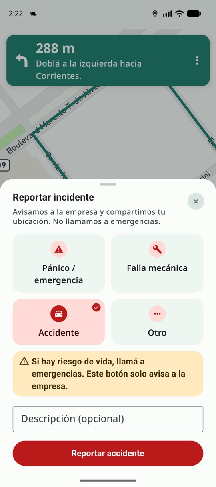
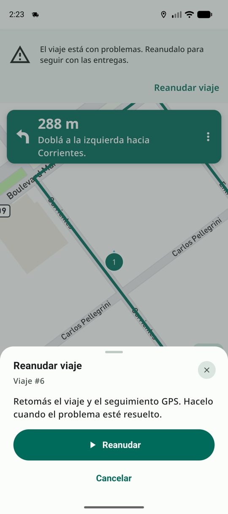

import { Steps } from '@astrojs/starlight/components';

Si algo te impide seguir con normalidad (una falla del vehículo, un accidente, una emergencia), reportalo desde la app. La empresa recibe el aviso con tu ubicación.

:::danger
Si hay riesgo de vida, **llamá primero a emergencias**. El botón de incidente de la app solo avisa a la empresa: **no llama a emergencias**.
:::

## Cómo reportar un incidente

El botón de **incidente** (triángulo rojo) está en la franja de abajo del mapa de navegación y también en el detalle del viaje.

<Steps>

1. Tocá el botón de **incidente**. Se abre **Reportar incidente**.
2. Elegí el tipo. No viene ninguno preseleccionado, para que no avises algo sin querer.
3. Si querés, escribí una **Descripción (opcional)**.
4. Tocá el botón rojo de abajo. Su texto cambia según el tipo elegido: por ejemplo, **Reportar accidente**.

</Steps>

*La hoja de incidente con **Accidente** elegido. Fijate en el aviso amarillo.*

## Tipos de incidente

| Tipo | Cuándo usarlo |
|------|---------------|
| **Pánico / emergencia** | Una situación de peligro o emergencia |
| **Falla mecánica** | El vehículo se rompió o no puede seguir |
| **Accidente** | Hubo un choque o accidente. Al elegirlo, la app te recuerda llamar a emergencias si hay riesgo de vida |
| **Otro** | Cualquier otro problema que impida seguir; describilo en la descripción |

Cuando se envía, la app confirma "Incidente reportado. Avisamos a la empresa."

## Qué pasa con el viaje

- Los incidentes de **pánico**, **falla mecánica** y **accidente** pasan el viaje a **Con problemas**. Mientras está así, las entregas quedan en pausa.
- **Otro** queda registrado, pero **no cambia** el estado del viaje.
- Los incidentes aparecen en el detalle del viaje y la empresa los ve en el panel web.

## Reanudar un viaje con problemas

Cuando el problema se resolvió, tenés que reanudar el viaje para seguir con las entregas.

<Steps>

1. Abrí el viaje: en la navegación aparece el aviso **"El viaje está con problemas. Reanudalo para seguir con las entregas."**
2. Tocá **Reanudar viaje**.
3. Confirmá con **Reanudar**. El viaje vuelve a **En camino** y se retoma el seguimiento por GPS.

</Steps>

*Aviso de viaje con problemas y la hoja **Reanudar viaje**.*

:::note
Un viaje **Con problemas** sigue contando como viaje en curso: no podés iniciar otro hasta reanudar o finalizar este. Si un Administrador cancela el viaje, lo ves como **Cancelado**, sin acciones.
:::

:::tip
Mientras estás sin conexión, el reporte se guarda y se envía apenas vuelve la señal ("Reporte guardado").
:::
