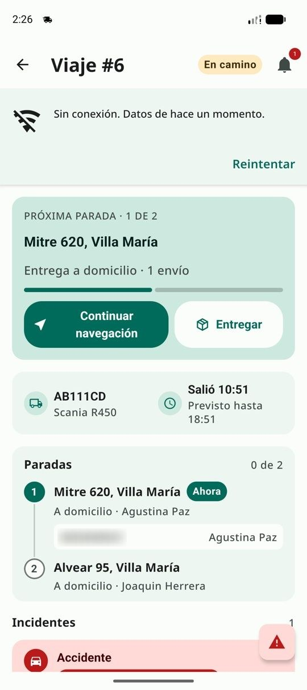

Durante el reparto es normal perder señal por tramos. La app está pensada para que puedas **seguir trabajando** y para que nada de lo que hiciste se pierda.

*El aviso de **Sin conexión** arriba del detalle del viaje.*

## Qué ves cuando no hay señal

- Un aviso arriba: **"Sin conexión. Datos de hace un momento."** (o "hace 5 min", según cuándo se actualizó por última vez). Muestra lo último que la app tenía guardado: tus viajes y el detalle de cada uno.
- El botón **Reintentar** del aviso vuelve a pedir los datos. Cuando hay señal, el aviso desaparece solo.
- Si falla una actualización puntual, la app lo avisa con **"No pudimos actualizar. Mostramos lo último guardado."**

## Qué pasa con lo que registrás

Podés seguir **entregando**, **registrando entregas fallidas** y **reportando incidentes**. Esas acciones se guardan en el teléfono y se envían solas, **en el orden en que las hiciste**, cuando vuelve la conexión.

| Acción | Mensaje que ves sin señal |
|--------|---------------------------|
| Entrega | **Entrega guardada**: "Sin conexión. La enviamos apenas vuelva la señal." y la etiqueta **Pendiente de envío** |
| Otras acciones | "Sin conexión. Lo guardamos y lo enviamos cuando vuelva la señal." |
| Incidente | "Reporte guardado." |

Mientras haya cambios sin enviar, aparece un aviso con la cantidad ("1 cambio sin enviar", "3 cambios sin enviar") y el botón **Enviar ahora**, para que fuerces el envío apenas recuperes señal.

:::caution
Si un cambio no se puede enviar (por ejemplo, el envío ya fue resuelto por otra vía), el aviso te lo marca y te da las opciones **Reintentar** o **Descartar**. Revisá el estado del viaje antes de descartar.
:::

## Tu ubicación

El seguimiento de tu recorrido también tolera los cortes: las posiciones se guardan y se envían **de a una, en orden**, cuando vuelve la señal, así la empresa recupera tu recorrido completo.

## Qué conviene hacer

- Antes de cerrar sesión, verificá que no queden cambios sin enviar.
- Cuando vuelva la señal, esperá a que el aviso de cambios pendientes desaparezca.
- Las **indicaciones de giro** necesitan conexión. Si te quedás sin señal, usá el mapa y la lista de paradas.

:::tip
Si pasás por una zona sin cobertura, seguí con la parada que tenés a mano: lo que registres se envía solo apenas recuperes conexión.
:::
