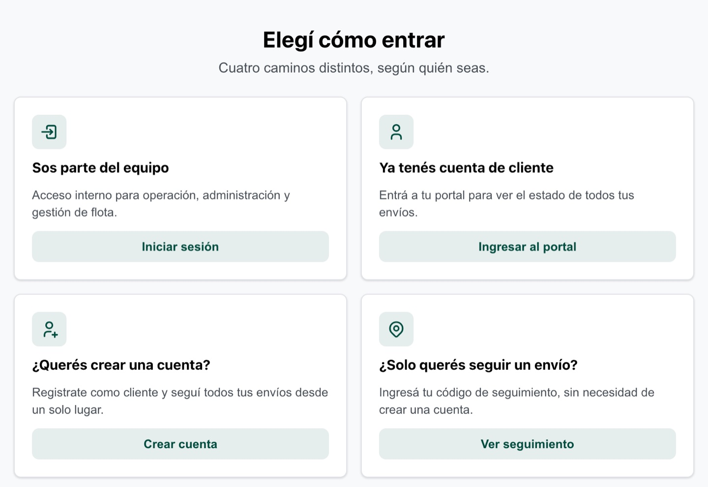
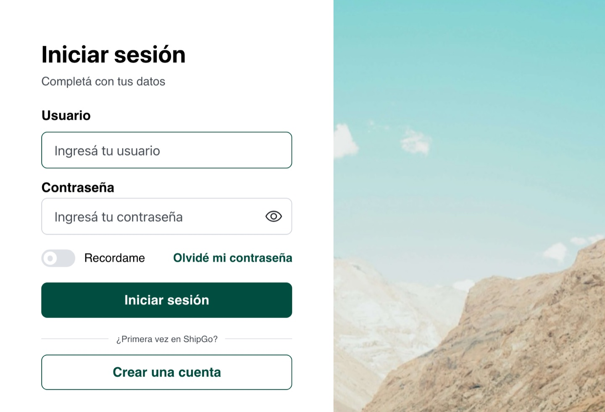
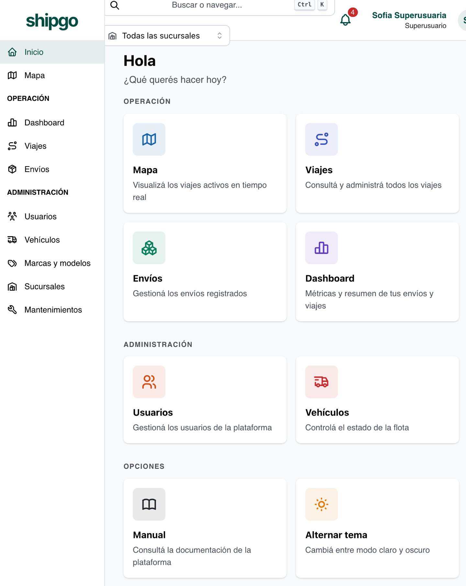
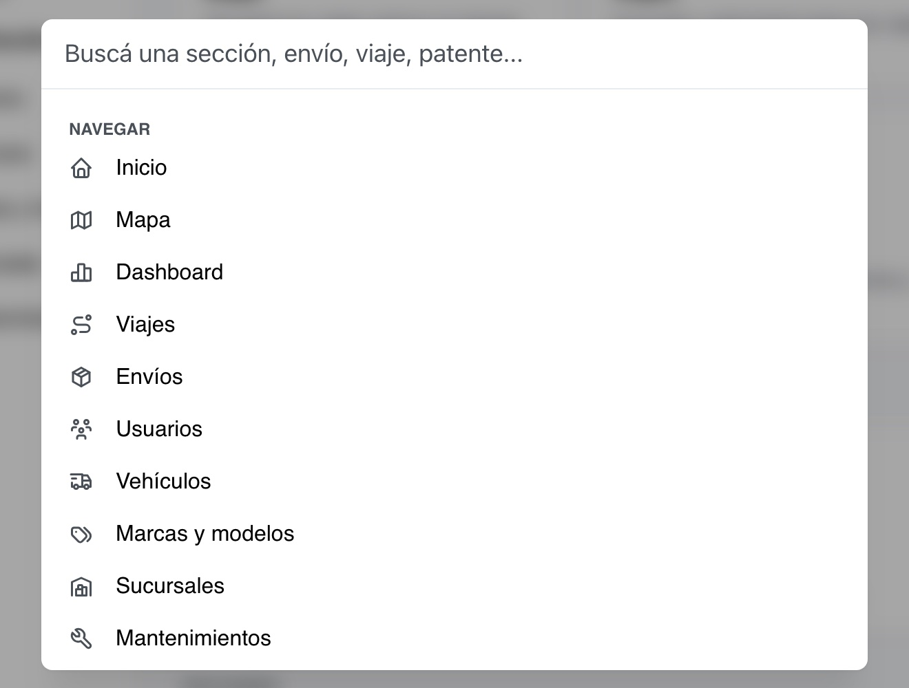

import { Steps } from '@astrojs/starlight/components';

**Quién puede usarlo:** Superusuarios y Administradores.

## Ingresar al panel

La pantalla de inicio pública ofrece cuatro caminos. El equipo de la empresa usa el primero.

*Figura: pantalla de inicio pública con los cuatro caminos de entrada.*

<Steps>

1. En la tarjeta **Sos parte del equipo**, hacé clic en **Iniciar sesión**.
2. Escribí tu **Usuario** y tu **Contraseña**. Con el ícono del ojo podés ver lo que escribiste.
3. Si estás en tu equipo personal, activá **Recordame** para que ShipGo! guarde tu usuario y te lo complete la próxima vez. Igual tenés que escribir la contraseña en cada ingreso.
4. Hacé clic en **Iniciar sesión**.

</Steps>

*Figura: formulario de ingreso del equipo.*

:::tip
Si te olvidaste la contraseña, hacé clic en **Olvidé mi contraseña**, escribí tu email y te enviamos un enlace para crear una nueva.
:::

### Primer ingreso

- **Superusuario sin empresa cargada:** el panel muestra solo **Configurá tu empresa**. Completá el nombre de la empresa y los datos de la primera sucursal; hasta entonces el resto del menú no está disponible.
- **Cuenta sin datos personales:** si tu cuenta todavía no tiene nombre, ShipGo! te pide **completar tu cuenta** antes de dejarte usar el panel.

:::caution
Si tu rol es **Chofer** u **Operario de carga**, al ingresar vas a ver el aviso **Usá la app móvil**: esas cuentas no tienen acceso al panel web. Hacé clic en **Cerrar sesión** y ingresá desde la app.
:::

## La pantalla de inicio

Después de ingresar llegás a **Inicio**. Muestra el saludo y tarjetas de acceso directo, agrupadas en **Operación** (Mapa, Viajes, Envíos, Dashboard), **Administración** (Usuarios, Vehículos) y **Opciones** (Manual y **Alternar tema**, para cambiar entre modo claro y oscuro).

*Figura: pantalla de inicio de un Superusuario. La captura corta el borde derecho de la barra superior, donde está el menú de la persona usuaria.*

El **menú lateral** tiene dos bloques:

- **Operación:** Dashboard, Viajes y Envíos (más **Inicio** y **Mapa** arriba de todo).
- **Administración:** Usuarios, Vehículos, Marcas y modelos, Sucursales (solo Superusuario) y Mantenimientos.

En la **barra superior** encontrás:

| Elemento | Qué hace |
|----------|----------|
| **Buscar o navegar… (Ctrl K)** | Abre el buscador. |
| **Selector de sucursal** | Solo para Superusuarios: elegí **Todas las sucursales** o una en particular para filtrar lo que ves. |
| **Campana** | Muestra tus [notificaciones](/manual/panel-web/notificaciones/), con un contador de las no leídas. |
| **Tu nombre y rol** | Abre un menú con **Mi perfil**, **Modo oscuro** y **Cerrar sesión**. |

## Buscador (Ctrl + K)

El buscador te lleva a cualquier sección o registro sin recorrer el menú.

<Steps>

1. Presioná **Ctrl + K** (en Mac, **Cmd + K**) o hacé clic en la barra **Buscar o navegar…**.
2. Escribí lo que buscás. Con menos de dos letras solo se filtran las secciones.
3. Elegí un resultado con el mouse o con las flechas y **Enter**.

</Steps>

*Figura: buscador sin texto. El grupo **Navegar** lista las secciones disponibles para tu rol; el fondo se difumina a propósito.*

A partir de dos letras, además de las secciones, el buscador consulta **envíos** (por código o nombre), **viajes** (por ejemplo, por patente del vehículo), **usuarios**, **vehículos** y **sucursales**, y agrupa los resultados por tipo.

:::note
Si no se puede conectar con el buscador de registros, el mensaje te lo avisa y podés seguir navegando por sección.
:::
