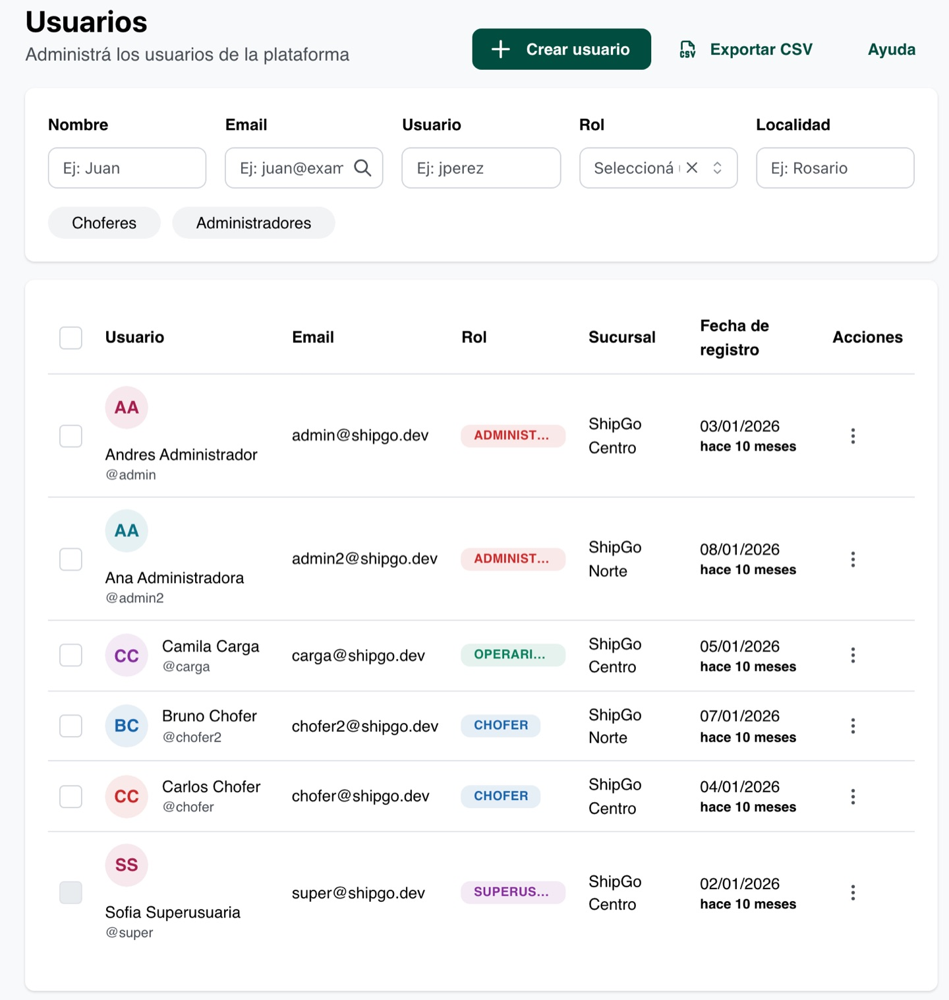

import { Steps } from '@astrojs/starlight/components';

**Quién puede usarla:** Superusuarios y Administradores. El bloque **Administración** del menú lateral reúne las pantallas de configuración:

| Pantalla | Para qué sirve |
|----------|----------------|
| **Usuarios** | Crear y administrar las personas que usan ShipGo! (esta página). |
| **Vehículos** | La flota. Ver [Vehículos y mantenimientos](/manual/panel-web/vehiculos-y-mantenimientos/). |
| **Marcas y modelos** | El catálogo de vehículos. Ver [Marcas y modelos](/manual/panel-web/catalogo-marcas-modelos/). |
| **Sucursales** | Solo Superusuarios. Ver [Sucursales](/manual/panel-web/sucursales/). |
| **Mantenimientos** | Períodos en que un vehículo no está disponible. |

## El listado de usuarios

*Figura: listado de usuarios de ejemplo. Los correos y nombres son de prueba.*

Podés filtrar por **Nombre**, **Email**, **Usuario**, **Rol** y **Localidad**, o usar los atajos **Choferes** y **Administradores**. Cada fila tiene un menú de tres puntos con las acciones de **ver**, **editar** y **eliminar** al usuario. El encabezado ofrece **Crear usuario** y **Exportar CSV**.

## Crear un usuario

<Steps>

1. En **Usuarios**, hacé clic en **Crear usuario**.
2. En **Información personal**, completá **Usuario**, **Nombre**, **Apellido**, **Fecha de nacimiento**, **Tipo de documento**, **DNI** y **Sexo**.
3. En **Información de contacto**, completá el **Email**, el **Prefijo** y el **Teléfono**.
4. En **Dirección**, completá la calle, el número, la **Provincia** y la **Localidad**.
5. En **Información laboral**, elegí los **Roles** y, si sos Superusuario, la **Sucursal**.
6. Guardá. Aparece el aviso **Usuario creado**.

</Steps>

No hace falta definir una contraseña: la persona recibe un **email de bienvenida** con un enlace para crearla, que vale por 7 días.

:::note
- Los **Administradores** pueden asignar los roles **Chofer** y **Operario de carga**, y los usuarios que crean quedan en su sucursal.
- Los **Superusuarios** además pueden asignar **Superusuario** y **Administrador**, y elegir la sucursal del usuario.
- Nadie puede cambiar sus propios roles ni su sucursal.
:::

## Mi perfil y modo oscuro

Desde el menú de tu nombre (arriba a la derecha) podés abrir **Mi perfil**, cambiar a **Modo oscuro** y **Cerrar sesión**. En tu perfil podés actualizar tu **foto de perfil**.

## Primer ingreso de un usuario nuevo

Si tu cuenta se creó sin tus datos personales completos, la primera vez que ingresás ShipGo! te pide **completar tu cuenta**. Si cambiás tu nombre de usuario en ese paso, tenés que volver a iniciar sesión con el nuevo.
