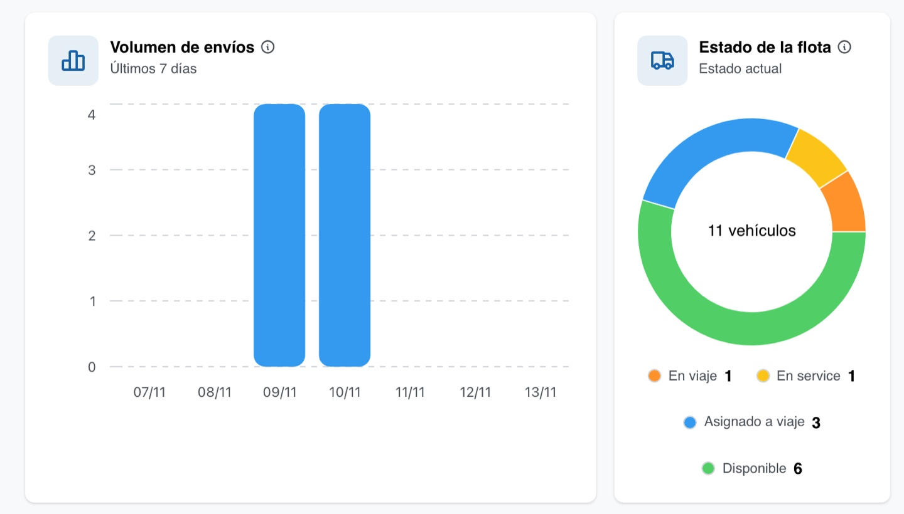

import { Steps } from '@astrojs/starlight/components';

**Quién puede usarlo:** Superusuarios y Administradores.

Debajo de los indicadores, el [Dashboard](/manual/panel-web/centro-de-accion/) tiene seis gráficos. Todos respetan el rango de fechas y la sucursal que elegiste, salvo **Estado de la flota**, que siempre muestra el estado de hoy.

*Figura: Volumen de envíos y Estado de la flota.*

| Gráfico | Qué muestra |
|---------|-------------|
| **Volumen de envíos** | Cantidad de envíos creados por día en el período. |
| **Estado de la flota** | Cuántos vehículos hay en cada estado hoy (disponible, asignado a viaje, en viaje, en service), con el total en el centro. |
| **Envíos por categoría** | Los paquetes del período, agrupados por categoría. |
| **Envíos por sucursal** | Los envíos del período agrupados por sucursal de origen. |
| **Envíos por estado** | Los envíos creados en el período, según su estado actual. |
| **Retraso o adelanto de los viajes finalizados** | Los minutos de diferencia entre lo planificado y lo real. Un valor positivo significa que el viaje terminó tarde. |

:::tip
Si un gráfico dice que no hay información, probá con un período más largo o con **Todas las sucursales**. Si muestra un error, hacé clic en el botón de reintentar de esa tarjeta.
:::

## Exportar el reporte

<Steps>

1. Elegí el período y, si sos Superusuario, la sucursal.
2. Hacé clic en **Exportar PDF**, arriba a la derecha.
3. Se descarga un PDF con el resumen del período: los cuatro indicadores y tablas con el volumen de envíos por día, por sucursal y por categoría, los **Envíos por estado**, la **Flota por estado** y el retraso o adelanto de los viajes finalizados. Incluye la sucursal y la fecha en que se generó.

</Steps>

:::note
El PDF respeta los filtros activos en el momento de exportar. Si cambiás el período, volvé a exportar.
:::

## Exportar listados a CSV

Los listados de **Envíos**, **Viajes**, **Usuarios**, **Vehículos**, **Mantenimientos** y **Marcas y modelos** tienen el botón **Exportar CSV** en el encabezado. Descarga todos los registros que coinciden con los filtros que tengas aplicados (no solo la página que ves), para trabajarlos en una planilla. Si hay demasiados, el sistema exporta los primeros y te avisa que la exportación se truncó: refiná los filtros para obtener el resto.
