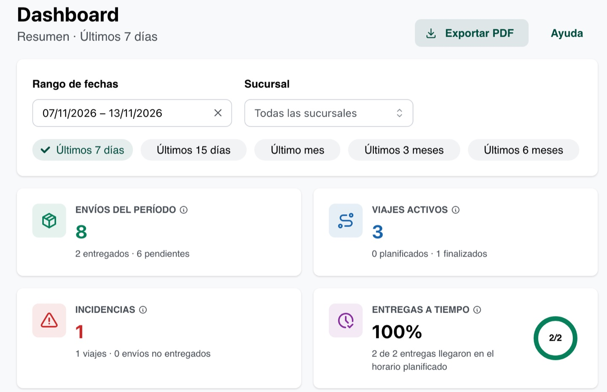

**Quién puede usarlo:** Superusuarios y Administradores. Se abre desde **Dashboard** en el menú lateral o desde la tarjeta **Dashboard** de Inicio.

El Dashboard es el punto de partida para saber cómo viene la operación. Arriba tiene los **filtros** y cuatro **indicadores**; abajo, los **gráficos**. Todo se recalcula cuando cambiás el período o la sucursal.

*Figura: parte superior del Dashboard con el período "Últimos 7 días".*

## Los cuatro indicadores

Pasá el mouse por el ícono **i** de cada tarjeta para ver qué mide.

| Indicador | Qué muestra |
|-----------|-------------|
| **Envíos del período** | Los envíos creados en el período, con el desglose de entregados y pendientes. |
| **Viajes activos** | Los viajes en carga o en camino. Debajo, como referencia, cuántos están planificados y cuántos finalizaron en el período. |
| **Incidencias** | Los viajes con problemas y los envíos no entregados del período. |
| **Entregas a tiempo** | El porcentaje de entregas que llegaron dentro del horario planificado del viaje, sobre el total de entregas con viaje. |

:::note
Si en el período no hubo entregas, **Entregas a tiempo** aparece con un guion (—) porque no hay con qué calcular el porcentaje.
:::

## Cambiar el período y la sucursal

- **Rango de fechas:** elegí un rango en el calendario o usá un atajo: **Últimos 7 días** (el predeterminado), **Últimos 15 días**, **Último mes**, **Últimos 3 meses** o **Últimos 6 meses**. Si limpiás el rango, vuelve a los últimos 7 días.
- **Sucursal:** solo los **Superusuarios** ven este selector. Un Administrador siempre ve los datos de su propia sucursal.

## Qué hacer a partir de lo que ves

- Si **Incidencias** es mayor que cero, abrí [Viajes](/manual/panel-web/gestion-viajes/) y filtrá por el estado **Con problemas**, o seguí el viaje en el [mapa en vivo](/manual/panel-web/monitoreo-tiempo-real/).
- Si hay muchos envíos **pendientes**, [armá un viaje](/manual/panel-web/gestion-viajes/) con los envíos que esperan en sucursal.
- Para ver el detalle de los gráficos y exportar el período, seguí con [Gráficos y reporte en PDF](/manual/panel-web/analisis-reportes/).
