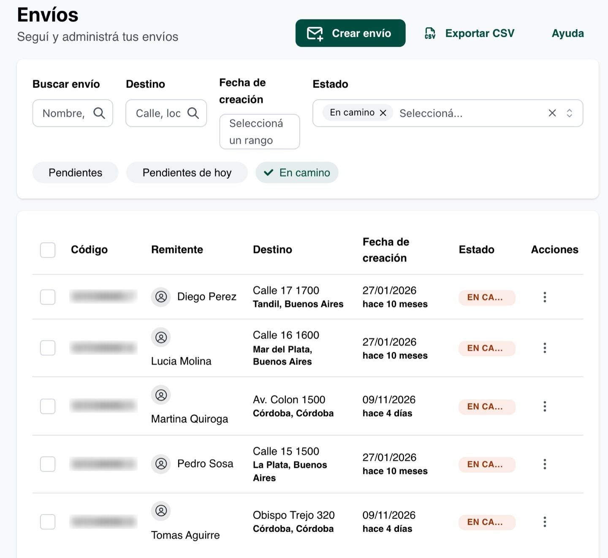
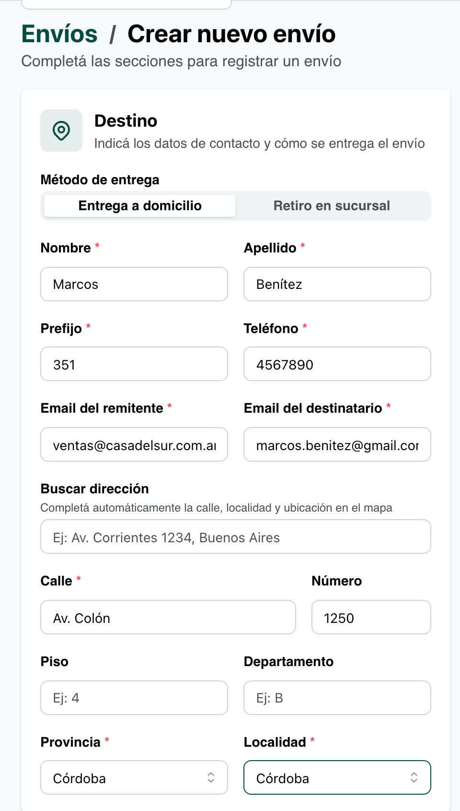
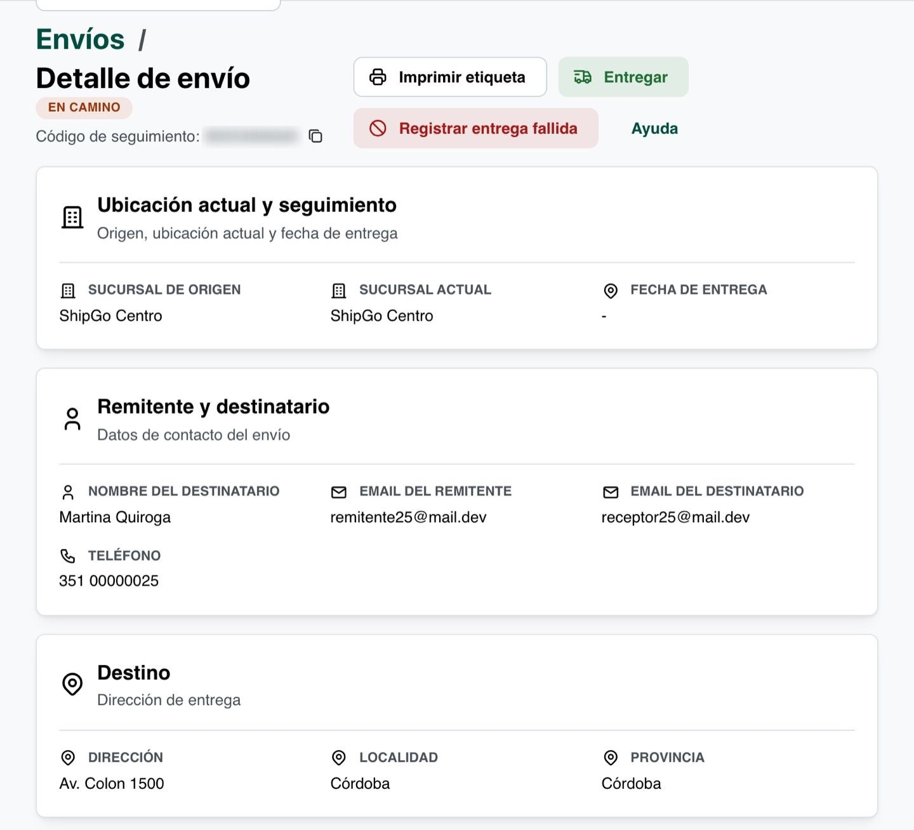

import { Steps } from '@astrojs/starlight/components';

**Quién puede usarlo:** Superusuarios y Administradores. Se abre desde **Envíos** en el menú lateral. Los Administradores trabajan con los envíos de su sucursal; los Superusuarios, con los de toda la empresa (o los de la sucursal que elijan en el selector de la barra superior).

## El listado de envíos

*Figura: listado de envíos con el atajo **En camino** activado.*

Para encontrar un envío podés usar:

- **Buscar envío:** por nombre, apellido o código de seguimiento.
- **Destino:** por calle, localidad o provincia.
- **Fecha de creación:** un rango de fechas.
- **Estado:** uno o varios estados.
- **Atajos:** **Pendientes** (envíos en sucursal), **Pendientes de hoy** (los de hoy que siguen en sucursal) y **En camino**. Hacé clic de nuevo en el atajo activo para quitarlo.

En el encabezado tenés **Crear envío**, **Exportar CSV** y **Ayuda**, que abre este manual.

### Acciones sobre uno o varios envíos

Cada fila tiene un menú de tres puntos con estas acciones:

| Acción | Qué hace |
|--------|----------|
| **Ver en el mapa** | Abre el [Mapa en vivo](/manual/panel-web/monitoreo-tiempo-real/) con el viaje del envío. Está disponible cuando el envío tiene un viaje **En camino** o **Con problemas**; si no, aparece deshabilitada y al pasar el mouse te explica por qué. |
| **Ver detalles** | Abre el detalle del envío. |
| **Imprimir etiqueta** | Abre la [etiqueta imprimible](/manual/panel-web/etiqueta-envio/). |
| **Editar** | Abre el formulario de edición. Está deshabilitada si el envío ya no se puede modificar. |
| **Eliminar** | Elimina el envío después de que lo confirmes. |

Si tildás varias filas aparece una barra con **Deseleccionar** y el menú **Acciones**, con **Exportar seleccionados** y **Eliminar seleccionados**.

:::caution
No se puede eliminar un envío que ya está asignado a un viaje, en el vehículo, en camino o entregado. En ese caso ShipGo! muestra el aviso **No se puede eliminar** con el motivo.
:::

## Crear un envío

<Steps>

1. En **Envíos**, hacé clic en **Crear envío**.
2. En **Destino**, elegí el **Método de entrega**: **Entrega a domicilio** o **Retiro en sucursal**.
3. Completá los datos de contacto: **Nombre**, **Apellido**, **Prefijo** y **Teléfono** del destinatario, el **Email del remitente** y el **Email del destinatario**.
4. Según el método:
   - **Entrega a domicilio:** escribí la dirección en **Buscar dirección** para autocompletar calle, localidad y ubicación en el mapa, o completá **Calle**, **Número**, **Piso**, **Departamento**, **Provincia** y **Localidad**. Podés ajustar el marcador en el mapa.
   - **Retiro en sucursal:** elegí la **Sucursal de retiro**; el destinatario va a poder retirar el envío ahí.
5. En **Paquetes del envío**, hacé clic en **Agregar paquete**, elegí la **Categoría**, el **Peso (kg)** y, si querés, una **Descripción**, y confirmá con **Agregar paquete**. Repetí el paso por cada paquete.
6. Revisá la sección [Palabra de entrega](/manual/panel-web/palabra-de-entrega/) y decidí si la generás.
7. Hacé clic en **Registrar envío**.

</Steps>

*Figura: parte superior del formulario de alta con datos de ejemplo, método **Entrega a domicilio**. Debajo siguen el mapa, los paquetes y la palabra de entrega.*

Al registrarlo, ShipGo! muestra el aviso **Envío creado** con el **código de seguimiento** y te lleva al detalle del envío. El origen del envío es la sucursal de tu usuario.

:::tip
Si hacés clic en **Cancelar** con datos cargados, el sistema te pregunta si querés salir sin guardar.
:::

## El detalle de un envío

Hacé clic en un envío del listado para abrir su detalle.

*Figura: detalle de un envío en camino. La captura es de datos de prueba; el campo **Fecha de entrega** muestra un guion porque el envío todavía no se entregó.*

Arriba ves el **estado**, el **código de seguimiento** (con un ícono para copiarlo) y los botones de acción. Más abajo, las secciones **Ubicación actual y seguimiento**, **Remitente y destinatario**, **Destino**, **Paquetes**, **Viaje** (el estado de la parada de este envío) e **Historial de estados**.

| Botón | Cuándo aparece |
|-------|----------------|
| **Imprimir etiqueta** | Siempre que el envío tenga código de seguimiento. |
| **Editar** | Mientras el envío se pueda modificar. |
| **Entregar** y **Registrar entrega fallida** | Cuando el envío está **En vehículo** o **En camino**. |
| **Confirmar retiro** | En envíos de **Retiro en sucursal** que ya están **En sucursal**. |

### Editar un envío

El envío se puede editar solo si todavía no está en un viaje ni terminó. Si no se puede, la pantalla de edición te avisa y te ofrece volver al detalle. La palabra de entrega no se puede cambiar después de crear el envío.

### Registrar una entrega desde el panel

Lo normal es que el chofer registre la entrega desde la app, pero un Superusuario o Administrador puede hacerlo desde el panel como excepción.

<Steps>

1. Abrí el detalle de un envío **En camino** o **En vehículo** y hacé clic en **Entregar**.
2. Escribí el **DNI de quien recibe**.
3. Si el envío tiene [palabra de entrega](/manual/panel-web/palabra-de-entrega/), aparece el campo **Palabra de entrega** y es **obligatorio**: escribí la que te dicte quien recibe. Si el envío no tiene palabra, el campo no aparece.
4. Hacé clic en **Sí, entregar**.

</Steps>

Para el caso contrario, hacé clic en **Registrar entrega fallida**, escribí el **Motivo** (es obligatorio) y confirmá. El envío pasa a **No entregado** y esta acción no se puede deshacer.

Para un **Retiro en sucursal**, **Confirmar retiro** pide el **DNI de quien retira** y, si el envío tiene palabra, la **palabra de entrega**, que en ese caso es obligatoria (si no tiene, el campo no aparece).

:::note
Cuando un envío queda **No entregado**, el detalle muestra un aviso rojo con la fecha de la entrega fallida y el motivo, si se registró.
:::
