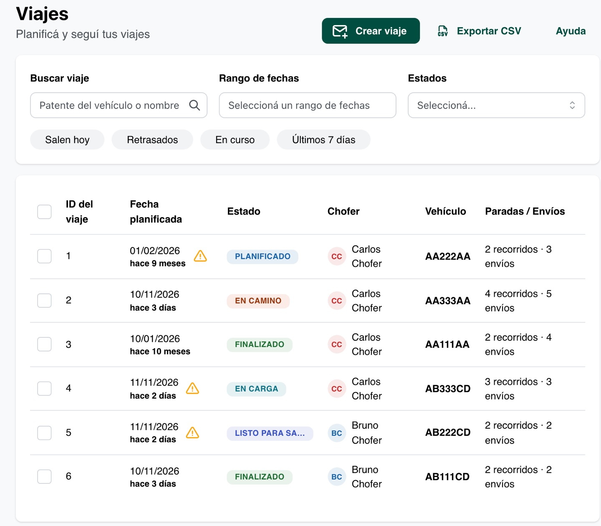
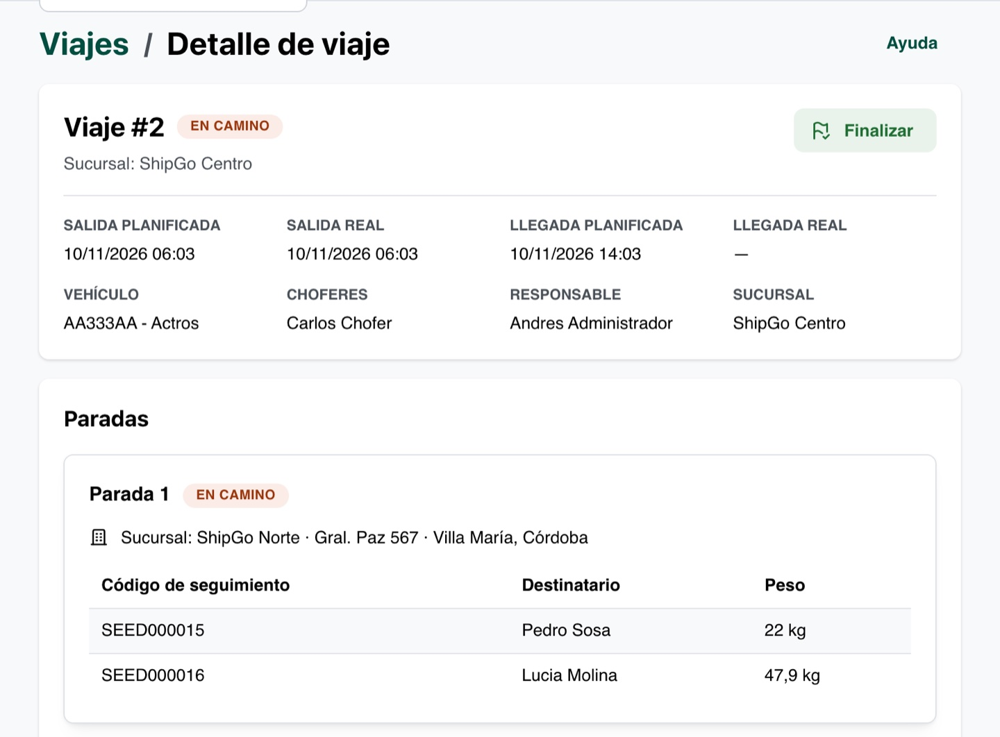

import { Steps } from '@astrojs/starlight/components';

**Quién puede usarlo:** Superusuarios y Administradores. Se abre desde **Viajes** en el menú lateral. El chofer inicia y ejecuta el viaje desde la [app móvil](/manual/app-mobile/mis-viajes/); desde el panel lo planificás y lo supervisás.

## El listado de viajes

*Figura: listado de viajes. Los viajes con un triángulo de advertencia junto a la fecha están retrasados.*

Filtros disponibles:

- **Buscar viaje:** por patente del vehículo o nombre.
- **Rango de fechas** y **Estados**.
- **Atajos:** **Salen hoy**, **Retrasados**, **En curso** y **Últimos 7 días**.

Cada fila muestra el estado del viaje con su etiqueta (ver [estados del viaje](/manual/introduccion/conceptos-basicos/)), el chofer, la patente y cuántas paradas y envíos tiene. Desde el menú de tres puntos de la fila podés elegir:

| Acción | Cuándo aparece |
|--------|----------------|
| **Ver hoja de ruta** | Siempre; abre el detalle del viaje. |
| **Editar viaje** | Si el viaje está **Creado** o **Planificado**. |
| **Cancelar viaje** | En los estados que se pueden cancelar (ver más abajo). |
| **Ver en el mapa** | Si el viaje está **En camino** o **Con problemas**. |

Si marcás varias filas, el menú **Acciones** de la barra inferior permite **Exportar seleccionados** y **Eliminar seleccionados**. Solo se eliminan los viajes que todavía no salieron; ShipGo! te avisa cuáles quedan afuera antes de confirmar.

## Crear un viaje

Hacé clic en **Crear viaje**. El formulario tiene tres secciones y un resumen.

<Steps>

1. **Detalles del viaje:** elegí la **Salida planificada** y la **Llegada planificada** (fecha y hora). La **Sucursal de origen** es la de tu usuario y no se puede cambiar. La llegada tiene que ser posterior a la salida.
2. **Selección de envíos:** a la izquierda están los **Envíos pendientes** (los que esperan en sucursal); a la derecha, los **Envíos seleccionados**. Buscá por código o destino, tildá los envíos que querés y usá el menú **Marcar envíos para…**:
   - **Entrega al destinatario:** el chofer lleva esos envíos al domicilio.
   - **Entrega en sucursal:** elegís una sucursal y el chofer deja ahí esos envíos (parada intermedia).
3. **Vehículo y choferes:** recién con las fechas elegidas se listan los **Vehículos disponibles** y los **Choferes disponibles** para ese horario. Elegí un vehículo y uno o más choferes.
4. **Resumen del viaje:** revisá las paradas en el mapa y en la línea de tiempo. Hacé clic en **Calcular ruta** para ver el recorrido y el orden de las paradas; podés subir o bajar una parada para reordenarla. Con el interruptor **Volver a la sucursal de origen al final** agregás el regreso a la ruta.
5. Hacé clic en **Crear viaje**.

</Steps>

Aparece el aviso **Viaje creado**. Si elegiste un solo chofer, el viaje queda **Planificado**. Si lo ofreciste a varios, queda **Creado** hasta que alguno lo acepte; recién entonces pasa a **Planificado**.

:::caution
- Si cambiás los envíos después de calcular la ruta, ShipGo! avisa **Cambiaste los envíos: volvé a calcular la ruta**.
- Un vehículo con **Capacidad insuficiente** para el peso de los envíos elegidos se marca como tal; podés ocultarlos con **Ocultar vehículos sin capacidad suficiente**.
- Un vehículo con un [mantenimiento](/manual/panel-web/vehiculos-y-mantenimientos/) que se superpone con las fechas del viaje no se puede elegir y muestra **En mantenimiento hasta…**.
:::

## El detalle de un viaje

*Figura: parte superior del detalle de un viaje en camino. Más abajo siguen el resto de las paradas, el historial de estados y el mapa del viaje.*

El detalle muestra el estado, la **Sucursal**, las fechas de **Salida** y **Llegada** (planificadas y reales), el **Vehículo**, los **Choferes** y el **Responsable**. Debajo, las **Paradas** con los envíos de cada una, el **Historial de estados** y el **Mapa del viaje** con la ruta, las paradas y el último punto conocido del camión.

## Acciones según el estado

| Botón | Estados en que está disponible | Qué hace |
|-------|-------------------------------|----------|
| **Editar** | Creado, Planificado | Permite cambiar los datos del viaje. |
| **Cancelar viaje** | Creado, Planificado, En carga, Listo para salir, Con problemas | Pide confirmación y un **Motivo (opcional)**. |
| **Finalizar** | En camino | Cierra el viaje. Es solo para emergencias. |
| **Reanudar** | Con problemas | Vuelve a poner el viaje **En camino** una vez resuelto el incidente. |

:::caution
**Cancelar** un viaje no se puede deshacer. Los envíos que todavía no se entregaron vuelven a la sucursal (estado **En sucursal**) y quedan disponibles para otro viaje; el vehículo vuelve a estar disponible. Lo que ya se entregó en un viaje **Con problemas** queda entregado.
:::

:::note
**Iniciar** el viaje no está en el panel: lo hace el chofer asignado desde la app móvil, y **Cerrar la carga** lo hace el operario de carga.
:::

## Qué hacer si un viaje queda "Con problemas"

<Steps>

1. Abrí el viaje y revisá el **Historial de estados** para ver cuándo cambió el viaje (y el motivo, si se registró).
2. Seguilo en el [Mapa en vivo](/manual/panel-web/monitoreo-tiempo-real/) y hablá con el chofer.
3. Si se resolvió, hacé clic en **Reanudar**. Si no se puede continuar, **Cancelar viaje**.

</Steps>
