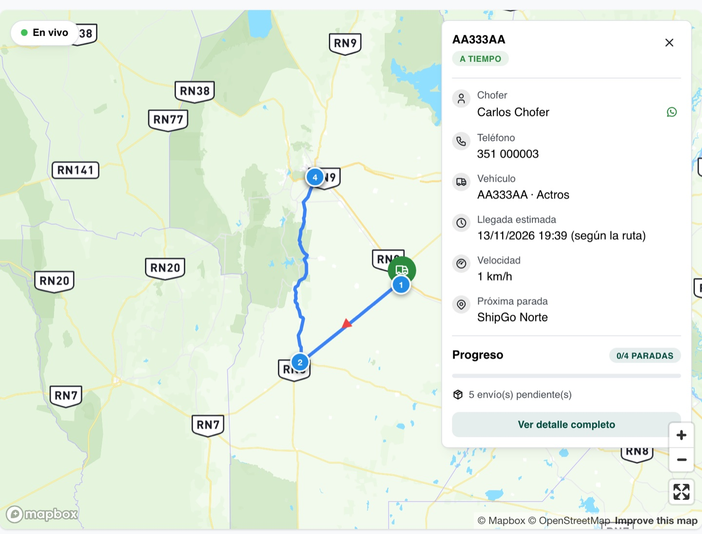

import { Steps } from '@astrojs/starlight/components';

**Quién puede usarlo:** Superusuarios y Administradores. Se abre desde **Mapa** en el menú lateral.

El **Mapa en vivo** muestra los viajes activos en tiempo real, con la posición de cada vehículo y la ruta que le falta recorrer.

*Figura: viaje seleccionado en el mapa. El recorte muestra el mapa con su panel de detalle; la lista de viajes queda fuera del encuadre.*

## Qué hay en la pantalla

- **Lista de viajes (a la izquierda):** un viaje por tarjeta, con la patente, el chofer, la sucursal, la llegada estimada y una etiqueta de estado (**A tiempo**, **Retrasado** o **Sin señal**; ver [Conceptos básicos](/manual/introduccion/conceptos-basicos/)). Arriba tiene un filtro por sucursal y un buscador por patente o chofer.
- **Mapa (al centro):** un camión por cada viaje, con el color de su estado. En la esquina superior izquierda, un indicador muestra la conexión: **En vivo**, **Reconectando…** o **Sin señal**.
- **Botón Nuevo viaje:** te lleva directo a [crear un viaje](/manual/panel-web/gestion-viajes/).

## Seguir un viaje

<Steps>

1. Hacé clic en un viaje de la lista (o en su camión en el mapa).
2. El mapa se centra en el vehículo y dibuja la **ruta** con sus **paradas numeradas** en orden.
3. En el panel de la derecha leés el **chofer** (con acceso directo a WhatsApp), su **teléfono**, el **vehículo**, la **llegada estimada**, la **velocidad**, la **próxima parada** y el **progreso** (paradas entregadas sobre el total y envíos pendientes).
4. Hacé clic en **Ver detalle completo** para abrir el [detalle del viaje](/manual/panel-web/gestion-viajes/).

</Steps>

Si hacés clic en el número de una **parada**, se abre un cuadro con su dirección, su estado y los envíos que incluye, con un ícono para llamar al destinatario.

### Recorrido GPS real

Además de la ruta planificada (en azul), el mapa dibuja en **naranja** el recorrido que el vehículo hizo de verdad, a partir de las ubicaciones GPS que informa el chofer. Sirve para comprobar si el chofer sigue la ruta prevista.

### Llegada estimada

La lista y el panel indican de dónde sale la hora:

- **(según la ruta):** se calcula con la ruta que falta recorrer.
- **(según plan):** todavía no hay datos de la ruta, así que se muestra la llegada planificada del viaje.

Por eso la hora de la lista y la del panel pueden diferir.

## Entrar directo a un viaje

Desde el listado de [Viajes](/manual/panel-web/gestion-viajes/) y de [Envíos](/manual/panel-web/gestion-envios-viajes/) podés usar la acción **Ver en el mapa**, que abre esta pantalla con el viaje ya seleccionado. Está disponible mientras el viaje está **En camino** o **Con problemas**.

## Qué hacer cuando un viaje está retrasado o sin señal

<Steps>

1. Ubicá el viaje en la lista: las etiquetas **Retrasado** y **Sin señal** lo distinguen.
2. Abrí el panel y revisá la velocidad, la próxima parada y la llegada estimada.
3. Si necesitás hablar con el chofer, usá el ícono de **WhatsApp** del panel.
4. Abrí **Ver detalle completo** para revisar paradas e historial de estados. Si el viaje quedó **Con problemas** y la situación se resolvió, usá **Reanudar** (ver [Viajes](/manual/panel-web/gestion-viajes/)).

</Steps>

:::note
**Sin señal** no significa que el viaje esté detenido: indica que hace más de 5 minutos que no llega una ubicación del vehículo (por ejemplo, por falta de cobertura en la ruta).
:::
