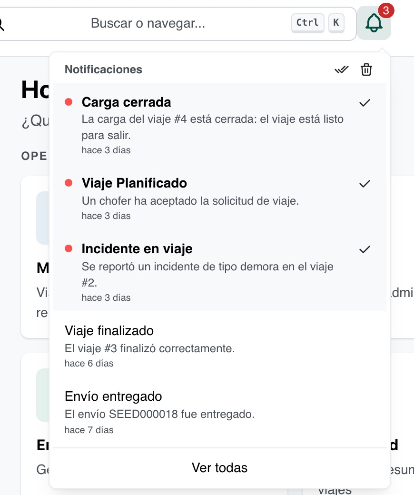

**Quién puede usarlas:** Superusuarios y Administradores.

ShipGo! te avisa de las novedades de la operación (por ejemplo, una carga cerrada, un viaje finalizado, un incidente reportado o un envío entregado) en una **bandeja de notificaciones**.

## La campana

La campana está en la barra superior, a la izquierda de tu nombre. Si tenés notificaciones sin leer, muestra un **contador** rojo (con "9+" cuando son más de nueve). El contador se actualiza solo cada tanto, sin que tengas que recargar la página.

*Figura: bandeja desplegada. Las notificaciones sin leer tienen un punto rojo, texto en negrita y fondo gris.*

Cada notificación muestra un **título**, un **texto** breve y cuánto hace que ocurrió (por ejemplo, "hace 3 días"). Si pasás el mouse por ese tiempo, ves la fecha y la hora exactas.

## Qué podés hacer

| Acción | Cómo |
|--------|------|
| **Ir al registro** | Hacé clic en la notificación: se marca como leída y te lleva al viaje, envío o usuario al que se refiere. |
| **Marcar una como leída** | Hacé clic en el tilde que aparece a la derecha. |
| **Marcar todas como leídas** | Hacé clic en el ícono de doble tilde, arriba de la lista. |
| **Vaciar todas** | Hacé clic en el ícono del tacho de basura y confirmá en **Vaciar todas**. Esta acción no se puede deshacer. |
| **Ver todas** | Hacé clic en **Ver todas**, al pie del menú, para abrir el historial completo. |

## El historial

La página **Notificaciones** lista todas tus notificaciones (menos las que vaciaste), de la más reciente a la más antigua, con paginación. Desde ahí también podés abrir cada registro y usar **Marcar todas como leídas**.

:::note
Si no tenés ninguna notificación, la bandeja dice **No tenés notificaciones**. Cuando haya novedades, las vas a ver ahí.
:::
