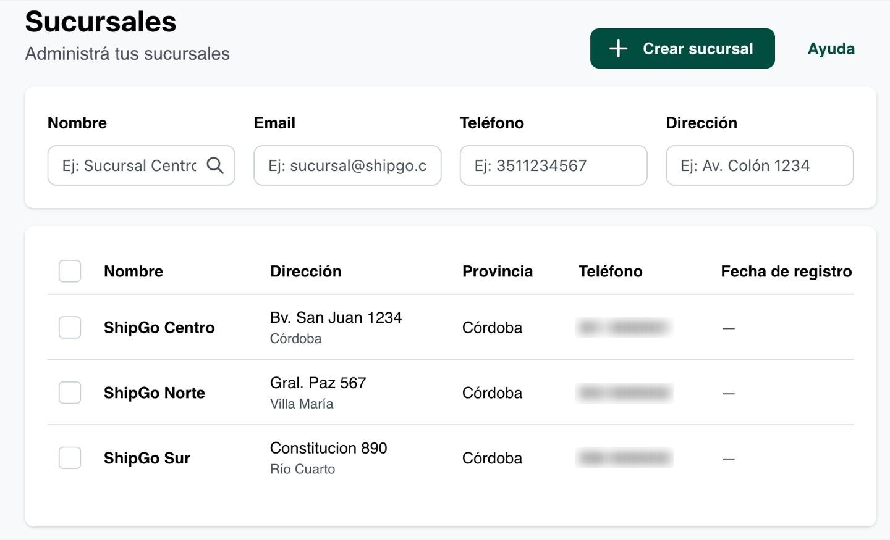
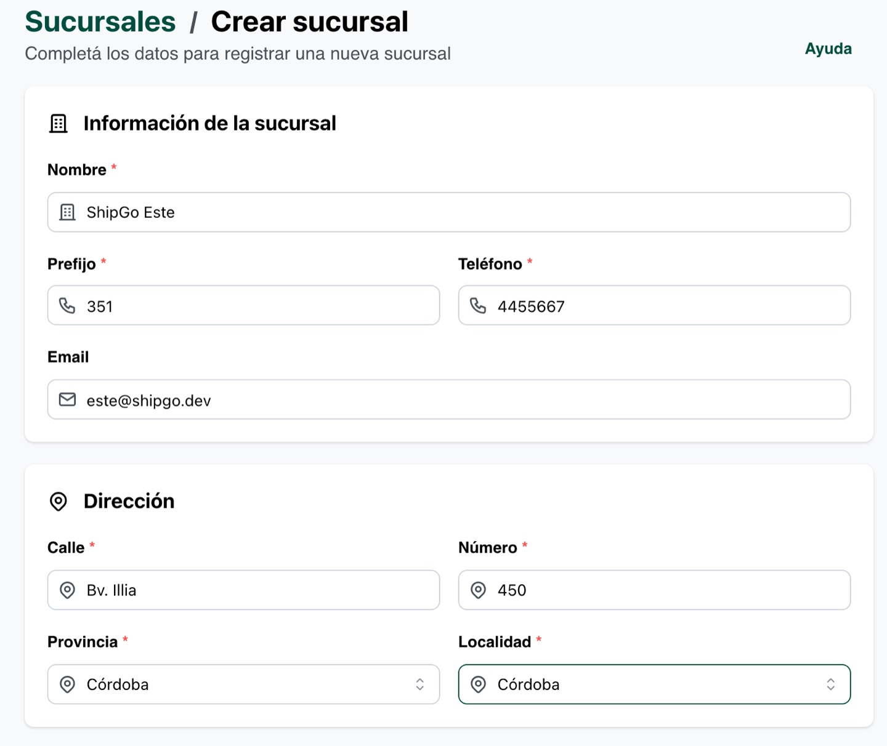

import { Steps } from '@astrojs/starlight/components';

**Quién puede usarla:** solo **Superusuarios**. Los Administradores no ven el menú **Sucursales**.

Una **sucursal** es un punto físico de la empresa: desde ahí salen los viajes, hacia ahí pueden llegar envíos para retirar y ahí se asignan los usuarios y los vehículos. Se administra desde **Sucursales**, en el bloque **Administración** del menú lateral.

## El listado de sucursales

*Figura: listado con tres sucursales de ejemplo. La columna **Fecha de registro** muestra un guion cuando la sucursal no tiene ese dato cargado.*

Podés filtrar por **Nombre**, **Email**, **Teléfono** y **Dirección**. Cada fila tiene un menú de tres puntos con **Ver detalles**, **Editar** y **Eliminar**.

## Crear una sucursal

<Steps>

1. En **Sucursales**, hacé clic en **Crear sucursal**.
2. En **Información de la sucursal**, completá el **Nombre**, el **Prefijo** y el **Teléfono**. El **Email** es opcional.
3. En **Dirección**, completá **Calle**, **Número**, **Provincia** y **Localidad**.
4. Guardá la sucursal.

</Steps>

*Figura: formulario de alta con datos de ejemplo. Los campos con asterisco son obligatorios.*

:::tip
Una vez creada, la sucursal aparece como opción al asignar usuarios, al elegir un punto de **Retiro en sucursal** en un envío y en el selector de sucursal de la barra superior.
:::

:::caution
Si intentás eliminar una sucursal que no se puede eliminar, ShipGo! muestra el aviso **No se pudo eliminar la sucursal** con el motivo.
:::
