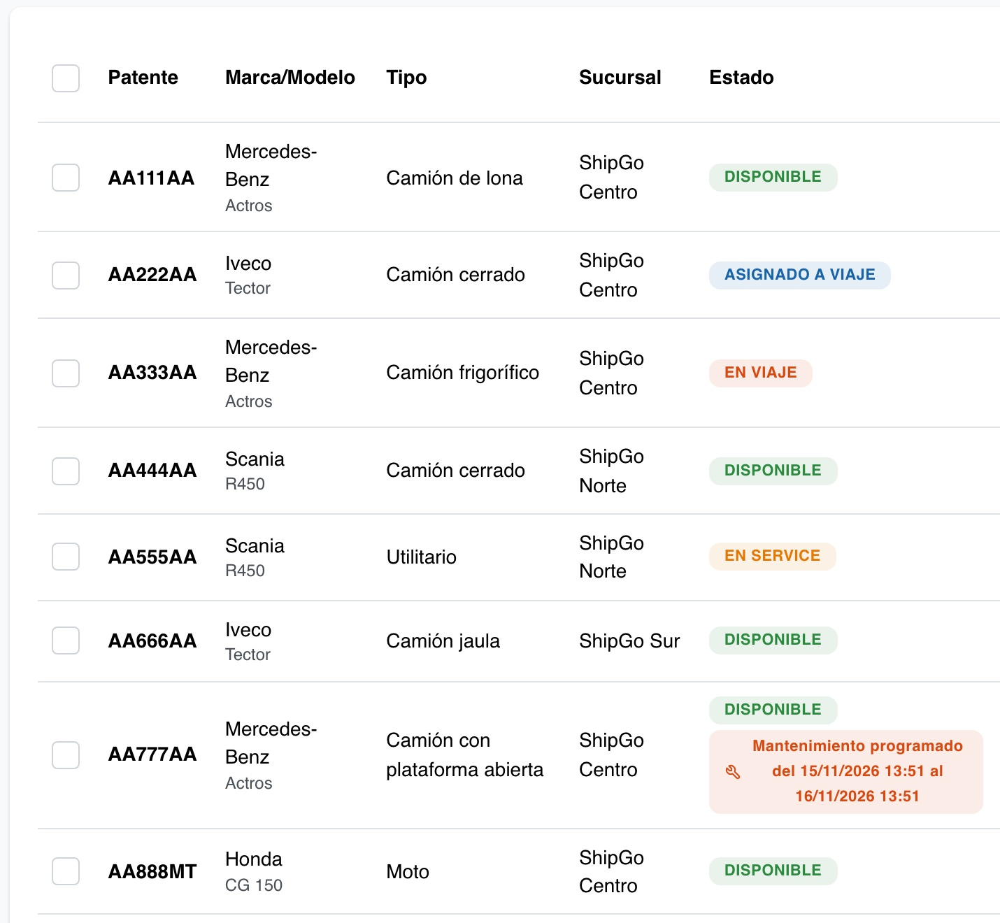
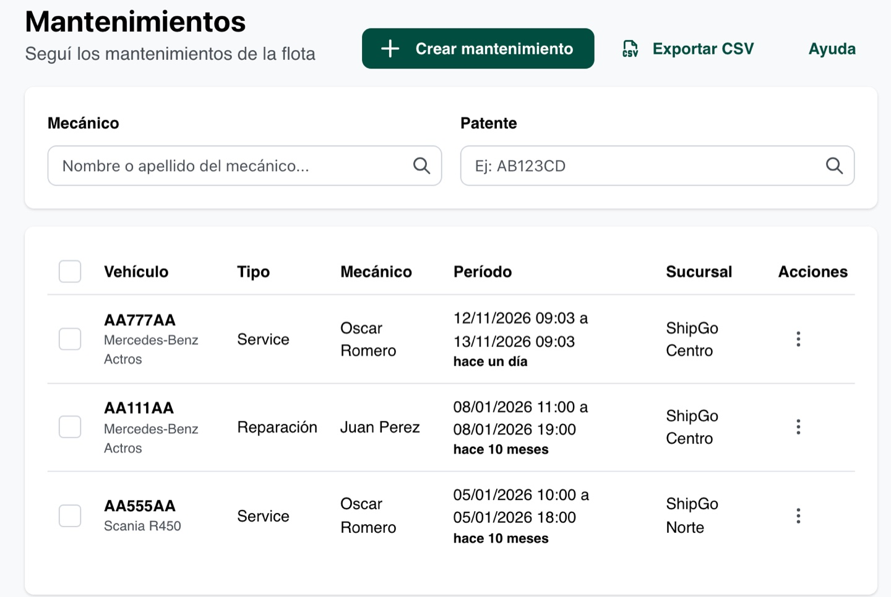

import { Steps } from '@astrojs/starlight/components';

**Quién puede usarlo:** Superusuarios y Administradores. **Vehículos** y **Mantenimientos** están en el bloque **Administración** del menú lateral.

## Vehículos

El listado muestra la flota de tu sucursal (los Superusuarios ven la de toda la empresa) con la **patente**, la **marca y el modelo**, el **tipo**, la **sucursal**, el **estado** y el **año de compra**.

*Figura: tabla de vehículos. La captura está recortada: no incluye el título ni los filtros. Uno de los vehículos, con estado Disponible, muestra el aviso de mantenimiento programado.*

### Estados de un vehículo

| Estado | Significado |
|--------|-------------|
| **Disponible** | Se puede asignar a un viaje. |
| **Asignado a viaje** | Ya tiene un viaje planificado. |
| **En viaje** | Está en reparto. |
| **En service** | Está en mantenimiento. |
| **Fuera de servicio** | No se puede usar. |

### Aviso de mantenimiento

Cuando un vehículo tiene un mantenimiento cargado, en la columna **Estado** y en su detalle aparece un aviso naranja:

- **Mantenimiento programado del DD/MM/AAAA HH:mm al DD/MM/AAAA HH:mm:** el mantenimiento todavía no empezó. Es el aviso para que no planifiques ahí un viaje.
- **En mantenimiento hasta el DD/MM/AAAA HH:mm:** el mantenimiento está en curso.

Al [armar un viaje](/manual/panel-web/gestion-viajes/), los vehículos cuyo mantenimiento se superpone con las fechas del viaje no se pueden elegir y muestran **En mantenimiento hasta…**.

### Buscar y filtrar

Podés filtrar por **Patente**, **Modelo**, **Tipo de vehículo** y **Combustible**. Los atajos **Camiones**, **Trafic** y **Motos** aparecen cuando existe ese tipo en el catálogo.

### Crear un vehículo

<Steps>

1. En **Vehículos**, hacé clic en **Crear vehículo**.
2. Completá **Patente** (formato `AA123BB` o `ABC123`; el sistema la pasa a mayúsculas), **Tipo de vehículo**, **Marca** y **Modelo**. Las marcas y modelos salen del [catálogo](/manual/panel-web/catalogo-marcas-modelos/): elegí primero la marca para que se habilite el modelo.
3. Completá **Año de compra**, **Kilometraje**, **Combustible** y **Consumo promedio**.
4. Completá **Tipo de rueda**, **Cantidad de ruedas** y **Peso máximo**.
5. Guardá. Aparece el aviso **Vehículo creado**.

</Steps>

:::caution
- Una moto tiene que tener **2 ruedas**; cualquier otro vehículo, **4 o más**. Para las motos, el **Peso máximo** es solo un valor de referencia.
- El **Año de compra** no puede ser anterior a 1900 ni posterior al año actual.
:::

Desde el menú de tres puntos de cada fila podés **Ver detalles**, abrir el **Historial de mantenimiento**, **Editar** o **Eliminar** el vehículo. Si no se puede eliminar, el aviso **No se pudo eliminar el vehículo** te explica el motivo.

## Mantenimientos

Un **mantenimiento** registra que un vehículo va a estar fuera de servicio entre dos fechas, quién lo hace y de qué tipo es (**Service** o **Reparación**).

*Figura: listado de mantenimientos con tres registros de ejemplo.*

### Programar un mantenimiento

<Steps>

1. En **Mantenimientos**, hacé clic en **Crear mantenimiento**.
2. Completá **Nombre del mecánico** y **Apellido del mecánico**.
3. Elegí el **Vehículo** y el **Tipo de mantenimiento**.
4. Elegí **Desde** y **Hasta** (fecha y hora de inicio y de fin).
5. Si querés, escribí una **Descripción**.
6. Guardá.

</Steps>

Reglas que aplica ShipGo!:

- El **inicio** no puede estar en el pasado, y el **fin** tiene que ser posterior al inicio.
- Un vehículo no puede tener dos mantenimientos que se superpongan.
- No se puede programar un mantenimiento en fechas en que el vehículo ya tiene un viaje. Primero reprogramá o cancelá ese viaje.

Podés buscar por **Mecánico** o por **Patente**. Desde el menú de tres puntos de cada fila: **Ver detalles**, **Editar** y **Eliminar**. Y desde el detalle de un vehículo, **Ver mantenimientos** abre el listado filtrado por su patente.

:::tip
Programá los mantenimientos con anticipación: mientras estén cargados, el vehículo muestra el aviso y no se ofrece para viajes que caigan en ese período.
:::
