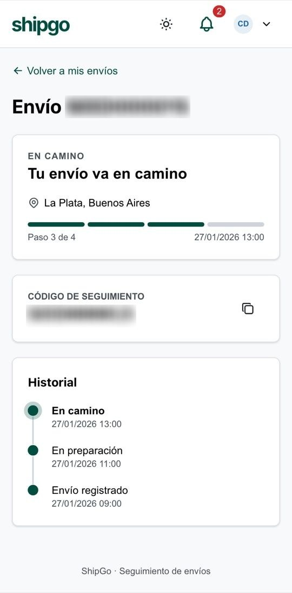

Al tocar un envío en **Mis envíos** se abre su detalle. Es la misma información del [seguimiento público](/manual/portal/seguimiento-publico/), pero dentro de tu cuenta.

*Detalle de un envío en camino. (Envío de prueba.)*

## Qué ves

1. **Volver a mis envíos**: el enlace de arriba te devuelve a la lista.
2. **Tarjeta de estado**: el estado en palabras simples (por ejemplo, **"Tu envío va en camino"**), el destino, la barra de **4 pasos** (**Paso 3 de 4**) y la fecha y hora del último movimiento.
3. **Código de seguimiento**: con un botón para copiarlo y pasárselo a quien quieras. Con ese código, cualquier persona puede consultar el estado en el [seguimiento público](/manual/portal/seguimiento-publico/).
4. **Historial**: los pasos que ya cumplió el envío (**Envío registrado**, **En preparación**, **En camino**, **Entregado**…), con fecha y hora, del más reciente al más antiguo.

## Cómo cambia según el tipo de entrega

- **A domicilio**: el último paso es **Entregado**.
- **Retiro en sucursal**: el último paso es **Retiro en sucursal**. Cuando el envío llega, el estado dice **"Tu envío está listo para retirar"**; una vez que lo retiran, **"Tu envío fue retirado"**.

Si el envío ya se entregó, la tarjeta muestra el día de la **entrega** (o del retiro). Si no se pudo entregar, se marca en rojo con **"No pudimos entregarlo"**.

:::note
El detalle muestra estado, destino por localidad e historial. **No muestra la ubicación del vehículo ni la palabra de entrega**: la palabra de entrega, si el envío la tiene, le llega por correo a quien lo envía, y la persona que recibe se la dice al Chofer en el momento de la entrega.
:::

:::caution
Si el detalle muestra "No encontramos ese envío" o "No pudimos conectar", tocá **Reintentar** o volvé a la lista. Si persiste, contactá a quien te envió el paquete.
:::
