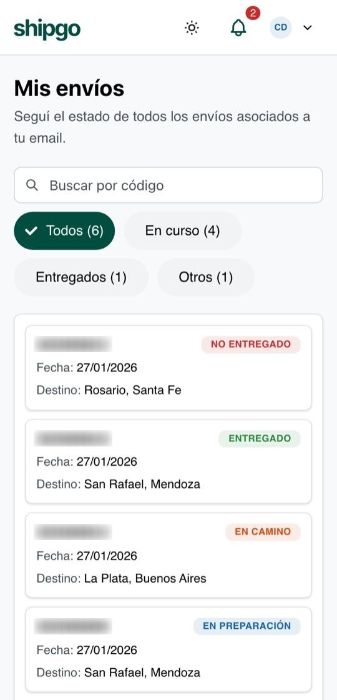

**Mis envíos** es la pantalla principal del portal: la lista de todos los envíos asociados a tu email. Es lo primero que ves al ingresar.

*Mis envíos en el celular: cada envío es una tarjeta con código, estado, fecha y destino. (Datos de prueba; los códigos están difuminados.)*

## Qué muestra cada envío

- **Código de seguimiento.**
- **Estado**, con un color: **Recibido**, **En preparación**, **En camino**, **Entregado** (o **Retirado** / **Listo para retirar** si es por sucursal) y **No entregado**.
- **Fecha**: cuándo se registró el envío.
- **Destino**: localidad y provincia.

Tocá un envío para abrir su [detalle](/manual/portal/detalle-envio/). En una computadora se ve como tabla (Código, Estado, Fecha, Destino); en el celular, como tarjetas.

## Buscar y filtrar

- **Buscar por código**: escribí parte del código y la lista se reduce.
- **Filtros** con contador:

| Filtro | Qué incluye |
|--------|-------------|
| **Todos** | Todos tus envíos |
| **En curso** | Los que todavía no se entregaron: recibidos, en preparación o en camino |
| **Entregados** | Los que ya se entregaron o retiraron |
| **Otros** | Los que no se pudieron entregar |

Si hay muchos envíos, se paginan: usá los números al pie para cambiar de página. Los filtros y el buscador trabajan sobre la página que estás viendo.

:::note
Si no ves ningún envío, aparece "Todavía no tenés envíos". Cuando alguien te envíe un paquete, o vos generes uno con el email de tu cuenta, va a aparecer acá. Si no encontrás uno que esperabas, revisá que tu cuenta use el mismo email con el que se registró el envío.
:::

:::tip
La campana de arriba te avisa de los cambios importantes; tocá **Ver todas** para ver el historial completo de notificaciones.
:::
