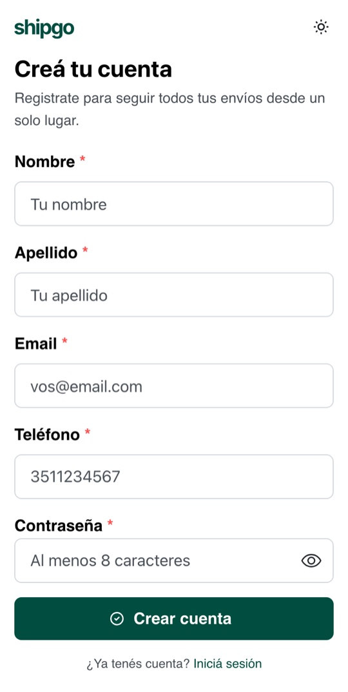

import { Steps } from '@astrojs/starlight/components';

Con una cuenta de cliente ves **todos tus envíos juntos**, sin tener que buscar código por código. La cuenta es gratuita y se crea en un minuto.

## Crear tu cuenta

<Steps>

1. Entrá a **Crear una cuenta** desde la portada de **ShipGo!** (o desde el enlace **Creá tu cuenta** al pie del seguimiento).
2. Completá **Nombre**, **Apellido**, **Email**, **Teléfono** y **Contraseña** (al menos 8 caracteres). Todos los campos son obligatorios.
3. Completá la verificación de seguridad si aparece.
4. Tocá **Crear cuenta**.

</Steps>

*Formulario de registro de clientes.*

:::tip
Registrate con el **mismo email** con el que te enviaron (o con el que enviás) los paquetes: el portal muestra los envíos asociados a tu email.
:::

## Verificar tu email

Al terminar, la pantalla dice **Revisá tu email**: te enviamos un correo con un enlace para verificar la cuenta.

<Steps>

1. Abrí el correo y tocá el enlace de verificación.
2. Vas a ver **Cuenta verificada**. Tocá **Iniciar sesión**.

</Steps>

:::caution
El enlace **vence a las 24 horas**. Hasta que no verifiques tu email no vas a poder ingresar: si lo intentás, aparece **Cuenta sin verificar**. Si el enlace venció o ya lo usaste, registrate de nuevo para recibir uno nuevo. Revisá también la carpeta de correo no deseado.
:::

## Ingresar al portal

<Steps>

1. Desde la portada, tocá **Soy cliente** o **Ingresar al portal** (también podés ir a `/portal/ingresar`).
2. Escribí tu email y tu contraseña.
3. Tocá **Iniciar sesión**. Llegás a **Mis envíos**.

</Steps>

Si te olvidaste la contraseña, usá **Olvidé mi contraseña** en la pantalla de ingreso: te enviamos un enlace por correo para crear una nueva.

:::note
Si ves "Usuario y/o contraseña incorrectos", revisá los datos. Si ves "Demasiados intentos", esperá unos minutos antes de probar de nuevo.
:::

## Tu cuenta

Arriba a la derecha del portal tenés:

- La **campana** con tus notificaciones.
- El **menú de tu cuenta** (tus iniciales): **Mis envíos**, **Mi perfil** y **Cerrar sesión**.
- El botón del **sol/luna** para cambiar entre modo claro y oscuro.

En **Mi perfil** podés revisar y editar tu **nombre**, **apellido** y **teléfono**. El email se muestra pero no se puede cambiar. Guardá con **Guardar cambios**.
