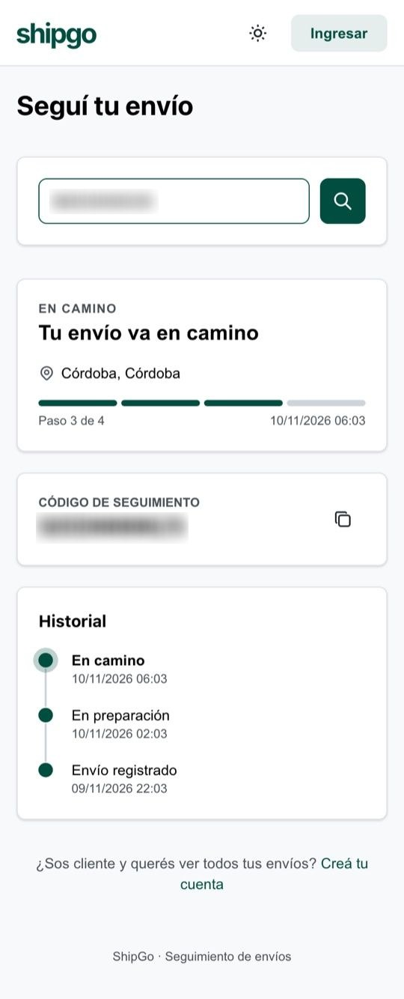

import { Steps } from '@astrojs/starlight/components';

Cualquier persona con el **código de seguimiento** de un envío puede ver en qué estado está, sin crear una cuenta.

## Dónde conseguir el código

El código está en el **correo de confirmación** que se envía cuando se registra el envío. Es una combinación de letras y números (suele tener 10), por ejemplo con este formato: `7K2M9QX4TP`.

## Consultar un envío

<Steps>

1. Entrá a la página **Seguí tu envío** (desde la portada de **ShipGo!** con **Seguir un envío**, o directo en la dirección `/tracking`).
2. Escribí el código en el campo **Código de seguimiento**. No importa si usás mayúsculas o minúsculas, ni si dejás espacios o guiones: se ignoran.
3. Completá la verificación de seguridad si aparece.
4. Tocá **Consultar** (en el celular, la lupa).

</Steps>

También podés entrar directo con el código en el enlace: `/tracking/CODIGO`, y la consulta se hace sola.

*Resultado de una consulta: estado, código e historial. (Envío de prueba.)*

## Cómo leer el resultado

- **Tarjeta de estado**: arriba en grande el estado, con una frase clara (por ejemplo, **"Tu envío va en camino"**), el **destino** (localidad y provincia), una barra de **4 pasos** y la fecha y hora del último movimiento.
- **Código de seguimiento**: con un botón para copiarlo.
- **Historial**: cada paso que cumplió el envío, con fecha y hora, del más reciente al más antiguo.

Los 4 pasos son:

| Paso | Qué significa |
|------|---------------|
| **1. Recibido** | Registramos el envío |
| **2. En preparación** | Se está preparando y cargando para salir |
| **3. En camino** | El envío salió y va hacia su destino |
| **4. Entregado** | Se entregó. En envíos con **retiro en sucursal**, este paso es **Retiro en sucursal**: primero dice **"Listo para retirar"** y, cuando lo retiran, **"Retirado"** |

Cuando el envío se entregó, además se muestra la fecha de **entrega** (o de retiro).

:::note
Si el envío no se pudo entregar, la tarjeta se marca en rojo con **"No pudimos entregarlo"** y el historial muestra **No entregado**. Contactá a quien te lo envió para coordinar una nueva entrega.
:::

## Errores comunes

| Mensaje | Qué hacer |
|---------|-----------|
| **Código inválido** | El código tiene que tener entre 6 y 16 letras y números, sin símbolos. Revisalo contra el correo. |
| **No encontramos ese envío** | Revisá que el código esté bien escrito. Si el envío es muy reciente, puede tardar unos minutos en aparecer. |
| **Demasiadas consultas** | Hiciste muchas consultas seguidas. Esperá un minuto. |
| **No pudimos completar la verificación de seguridad** | Completala de nuevo y volvé a consultar. |
| **No pudimos conectar** | Revisá tu conexión a internet y tocá **Reintentar**. |

:::tip
Este seguimiento no muestra dónde está el vehículo en el mapa ni datos personales. Muestra el estado, el historial y el destino por localidad, para cuidar la privacidad de todos.
:::

Al pie de la página hay un enlace **Creá tu cuenta** si querés ver todos tus envíos juntos.
